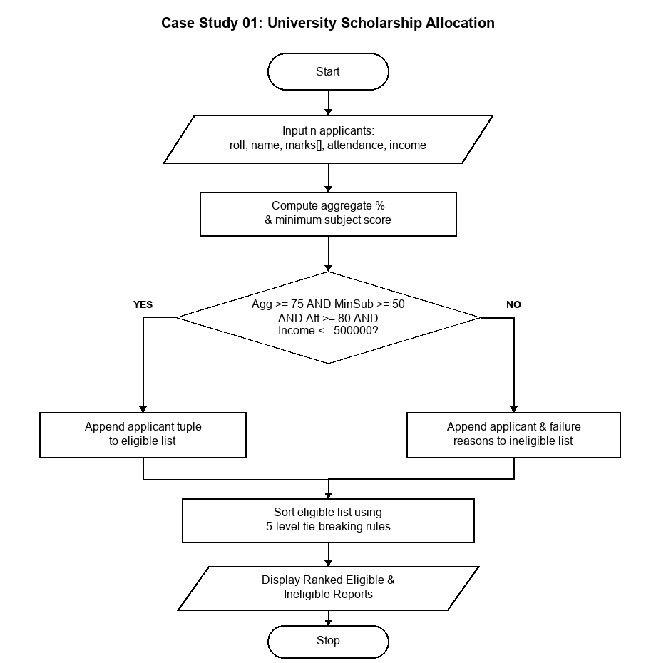
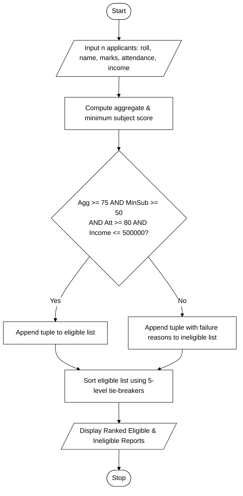
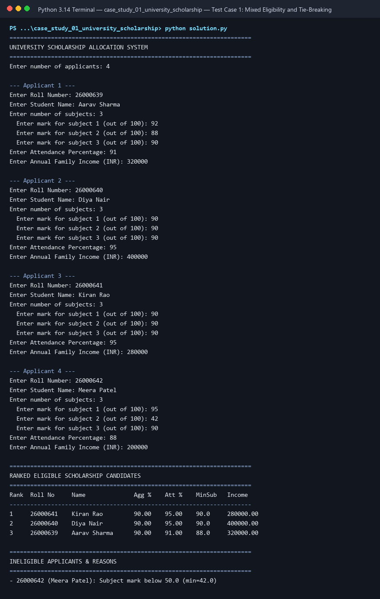
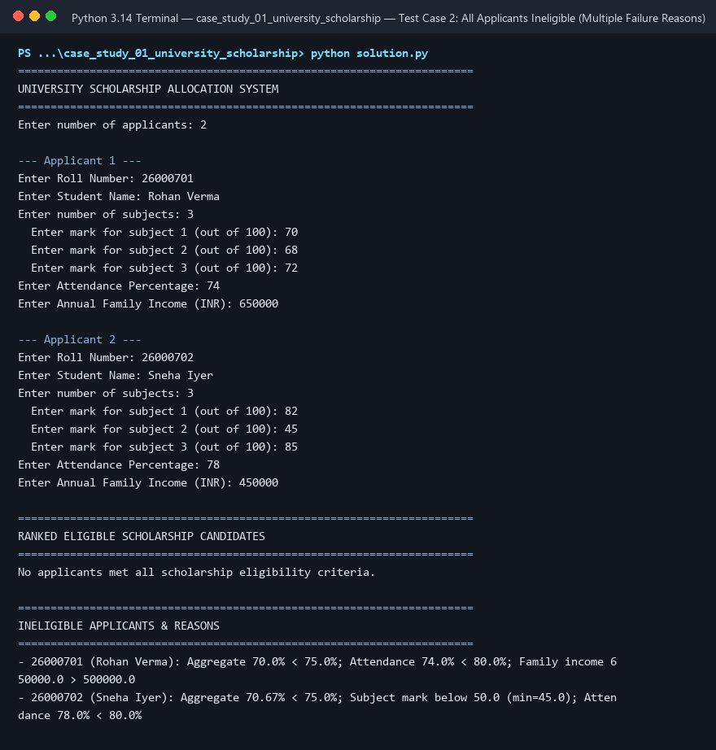
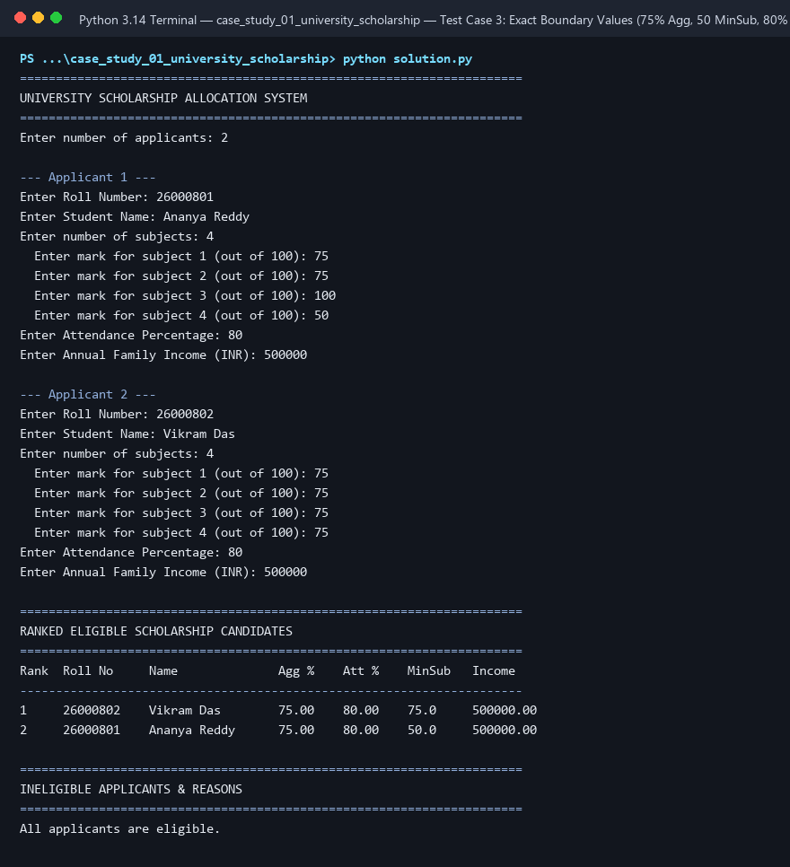

# Case Study 1: University Scholarship Allocation

- **Student Roll Number:** `26000639`
- **Source Code:** [solution.py](./solution.py)
- **Standalone Files:** [algorithm.md](./algorithm.md) | [pseudocode.md](./pseudocode.md) | [flowchart.png](./flowchart.png)
- **Syllabus Concepts Used:** Computational thinking, algorithms, flowcharts, pseudocode, variables, data types, operators, conditional statements, loops, strings, lists, nested lists, tuples, unpacking.

---

## 1. Problem Statement
Design a Python-based University Scholarship Allocation system that evaluates student applicants using aggregate marks, subject-wise minimum scores, attendance percentage, and annual family income criteria. The system must separate eligible and ineligible candidates (reporting specific unmet criteria for ineligible students), rank eligible candidates, and resolve ties deterministically using predefined tie-breaking rules.

## 2. Objectives
- Collect academic, attendance, and family income details for `n` scholarship applicants.
- Compute each applicant's aggregate percentage and lowest subject score.
- Enforce multi-criteria eligibility rules simultaneously and list all failure reasons for ineligible students.
- Rank eligible candidates using a 5-level tie-breaking policy implemented with loops and tuple unpacking.

## 3. Assumptions
- Minimum required aggregate percentage is `75.0%`.
- Minimum required score in every individual subject is `50.0` out of `100`.
- Minimum required attendance percentage is `80.0%`.
- Maximum eligible annual family income is `INR 500,000.00`.
- Every applicant has at least 1 subject mark entered on a `0–100` scale.
- Tie-breaking priority order: (1) Higher aggregate %, (2) Higher attendance %, (3) Lower family income, (4) Higher minimum subject mark, (5) Alphabetical order of student name.

## 4. Algorithm
1. **Start** and read the number of applicants `n`.
2. For each applicant `i` from `1` to `n`:
   - Read `roll`, `name`, `num_subj`, individual subject marks into list `marks`, `attendance`, and `income`.
   - Calculate `aggregate = total_marks / num_subj`.
   - Store `(roll, name, marks, aggregate, attendance, income)` in `applicants`.
3. Initialize empty lists `eligible` and `ineligible`.
4. For each tuple in `applicants`:
   - Unpack `(roll, name, marks, aggregate, attendance, income)` and initialize `reasons = []`.
   - Check `aggregate < 75.0`, any mark `< 50.0`, `attendance < 80.0`, and `income > 500000.0`; append any violated conditions to `reasons`.
   - If `reasons` is empty, append `(roll, name, round(aggregate, 2), round(attendance, 2), income, min_sub)` to `eligible`; otherwise append `(roll, name, reasons)` to `ineligible`.
5. Sort `eligible` using nested loops (bubble sort) comparing the 5 tie-breaking fields via tuple unpacking.
6. Print the ranked table of eligible scholarship candidates and the detailed list of ineligible applicants with reasons.
7. **Stop**.

## 5. Flowchart





## 6. Pseudocode
```text
BEGIN
    INPUT n
    SET applicants = []
    FOR i = 1 TO n DO
        INPUT roll, name, num_subj
        SET marks = [], total = 0
        FOR j = 1 TO num_subj DO
            INPUT m
            APPEND m TO marks
            total = total + m
        END FOR
        aggregate = total / num_subj
        INPUT attendance, income
        APPEND (roll, name, marks, aggregate, attendance, income) TO applicants
    END FOR

    SET eligible = [], ineligible = []
    FOR EACH (roll, name, marks, aggregate, attendance, income) IN applicants DO
        SET reasons = []
        Find min_sub across marks
        IF aggregate < 75.0 THEN APPEND "Low aggregate" TO reasons
        IF min_sub < 50.0 THEN APPEND "Subject below 50" TO reasons
        IF attendance < 80.0 THEN APPEND "Low attendance" TO reasons
        IF income > 500000.0 THEN APPEND "Income exceeds limit" TO reasons
        IF LENGTH(reasons) == 0 THEN
            APPEND (roll, name, aggregate, attendance, income, min_sub) TO eligible
        ELSE
            APPEND (roll, name, reasons) TO ineligible
        END IF
    END FOR

    SORT eligible BY (aggregate DESC, attendance DESC, income ASC, min_sub DESC, name ASC)
    PRINT eligible, ineligible
END
```

## 7. Test Cases

| Test Case | Scenario | Key Inputs | Expected Outcome | Status |
| :--- | :--- | :--- | :--- | :--- |
| **TC 1** | Mixed eligibility & multi-level tie-breaking | 4 applicants: Aarav (`90% agg, 91% att`), Diya (`90% agg, 95% att, 400k`), Kiran (`90% agg, 95% att, 280k`), Meera (`42` in Subj 2) | Ranks: 1. Kiran (`26000641`), 2. Diya (`26000640`), 3. Aarav (`26000639`); Meera flagged for subject mark `< 50.0` | Passed |
| **TC 2** | All applicants ineligible with multiple simultaneous failures | Rohan (`70% agg, 74% att, 650k`), Sneha (`70.67% agg, 45 min, 78% att`) | Eligible list empty; both students listed with all specific unmet criteria | Passed |
| **TC 3** | Exact boundary thresholds & min-subject tie-breaker | Ananya (`75% agg, min=50, 80% att, 500k`) vs Vikram (`75% agg, min=75, 80% att, 500k`) | Both eligible; Vikram ranked #1 over Ananya due to higher `MinSub` (`75.0` vs `50.0`) | Passed |

## 8. Output Screenshots

### Test Case 1


### Test Case 2


### Test Case 3


## 9. Conclusion
The University Scholarship Allocation system successfully automates multi-criteria candidate screening, transparently reports all disqualifying factors, and resolves equal-score ties deterministically using only core Python constructs (lists, tuples, unpacking, loops, and conditionals).
