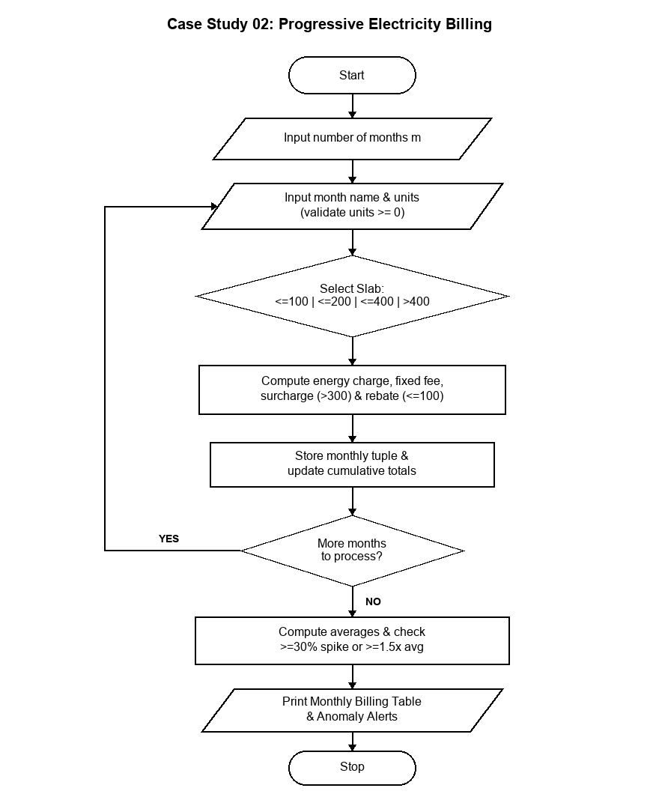
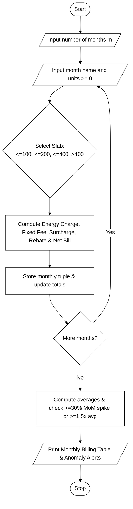
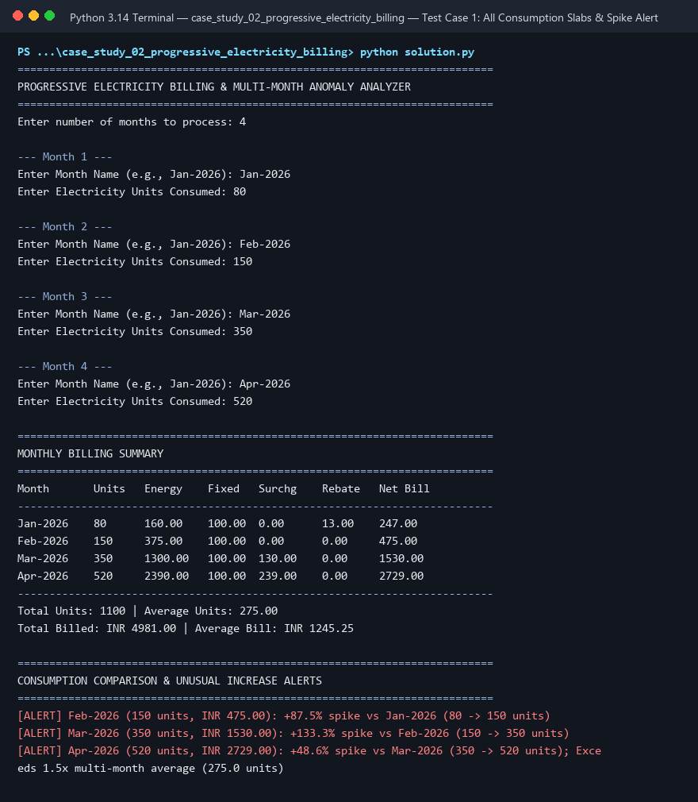
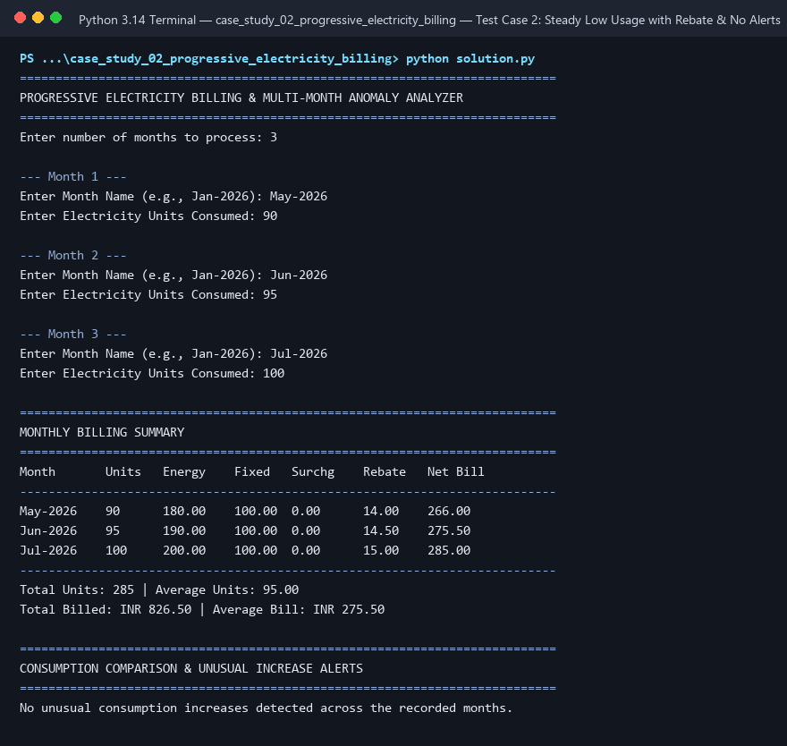
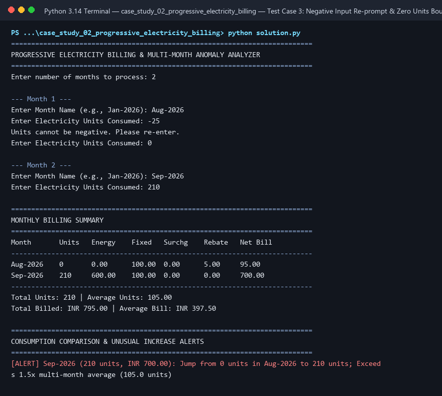

# Case Study 2: Progressive Electricity Billing

- **Student Roll Number:** `26000639`
- **Source Code:** [solution.py](./solution.py)
- **Standalone Files:** [algorithm.md](./algorithm.md) | [pseudocode.md](./pseudocode.md) | [flowchart.png](./flowchart.png)
- **Syllabus Concepts Used:** Computational thinking, algorithms, flowcharts, pseudocode, variables, data types, operators, conditional statements, loops, strings, lists, tuples, unpacking.

---

## 1. Problem Statement
Develop a Python program that calculates monthly household electricity bills using progressive consumption slabs, fixed charges, high-usage surcharges, and low-usage rebates. After computing bills across multiple months, the system must compare consumption patterns and flag months with unusual increases.

## 2. Objectives
- Validate non-negative monthly consumption inputs using `while` loops.
- Apply tiered progressive unit pricing slabs accurately across four brackets.
- Incorporate fixed charges, surcharges, and rebates into each monthly net bill.
- Detect unusual monthly consumption spikes relative to both the preceding month and the multi-month average.

## 3. Assumptions
- Consumption slabs:
  - `0–100` units: `INR 2.00 / unit`
  - `101–200` units: `INR 3.50 / unit`
  - `201–400` units: `INR 5.00 / unit`
  - Above `400` units: `INR 7.00 / unit`
- Monthly fixed charge is `INR 100.00`.
- Surcharge is `10%` of energy charge when consumption exceeds `300` units.
- Rebate is `5%` of subtotal (`energy + fixed + surcharge`) when consumption is `<= 100` units.
- An unusual increase is flagged if a month rises by `>= 30%` over the previous month (or rises from `0` to `> 0`) OR exceeds `1.5x` the multi-month average units.

## 4. Algorithm
1. **Start** and read the number of months `num_months`.
2. Initialize `monthly_records = []`, `total_units_all = 0`, and `total_bill_all = 0.0`.
3. Loop `i` from `1` to `num_months`:
   - Input `month_name` and `units`; re-prompt while `units < 0`.
   - Compute `energy_charge` using progressive `if/elif/else` slabs.
   - Compute `surcharge = energy_charge * 0.10` if `units > 300`, else `0.0`.
   - Compute `subtotal = energy_charge + 100.0 + surcharge`.
   - Compute `rebate = subtotal * 0.05` if `units <= 100`, else `0.0`.
   - Compute `net_bill = round(subtotal - rebate, 2)` and append monthly tuple to `monthly_records`.
4. Compute `avg_units` and `avg_bill` across all months.
5. Unpack each tuple to display the formatted billing summary table.
6. Loop through `monthly_records` to compare consecutive months and against `1.5 * avg_units`, printing `[ALERT]` for anomalies.
7. **Stop**.

## 5. Flowchart





## 6. Pseudocode
```text
BEGIN
    INPUT num_months
    SET monthly_records = [], total_units = 0, total_bill = 0
    FOR i = 1 TO num_months DO
        INPUT month_name, units
        WHILE units < 0 DO
            INPUT units
        END WHILE
        Compute energy_charge using progressive slabs (2.0, 3.5, 5.0, 7.0)
        IF units > 300 THEN surcharge = 0.10 * energy_charge ELSE surcharge = 0
        subtotal = energy_charge + 100 + surcharge
        IF units <= 100 THEN rebate = 0.05 * subtotal ELSE rebate = 0
        net_bill = subtotal - rebate
        APPEND (month_name, units, energy_charge, 100, surcharge, rebate, net_bill) TO monthly_records
        total_units = total_units + units
        total_bill = total_bill + net_bill
    END FOR
    avg_units = total_units / num_months
    PRINT monthly billing table
    FOR idx = 0 TO num_months - 1 DO
        Check >= 30% increase over previous month OR >= 1.5 * avg_units
        IF anomaly THEN PRINT alert
    END FOR
END
```

## 7. Test Cases

| Test Case | Scenario | Key Inputs | Expected Outcome | Status |
| :--- | :--- | :--- | :--- | :--- |
| **TC 1** | All 4 tariff slabs & spike alerts | `Jan-2026: 80`, `Feb-2026: 150`, `Mar-2026: 350`, `Apr-2026: 520` | Bills: `247.00`, `475.00`, `1530.00`, `2729.00`; alerts triggered on Feb (`+87.5%`), Mar (`+133.3%`), and Apr (`+48.6%` & `>=1.5x avg`) | Passed |
| **TC 2** | Steady low usage with rebate & no alerts | `May-2026: 90`, `Jun-2026: 95`, `Jul-2026: 100` | All months get 5% rebate (`266.00`, `275.50`, `285.00`); no unusual increase alerts | Passed |
| **TC 3** | Negative unit validation & zero-unit jump | `Aug-2026: -25 -> 0`, `Sep-2026: 210` | Re-prompts on `-25`, computes `95.00` for `0` units (`100 - 5%`), flags Sep jump from `0` to `210` | Passed |

## 8. Output Screenshots

### Test Case 1


### Test Case 2


### Test Case 3


## 9. Conclusion
The Progressive Electricity Billing program accurately models slab-based utility pricing, handles surcharges and rebates cleanly, validates negative readings, and identifies anomalous consumption spikes across billing cycles.
