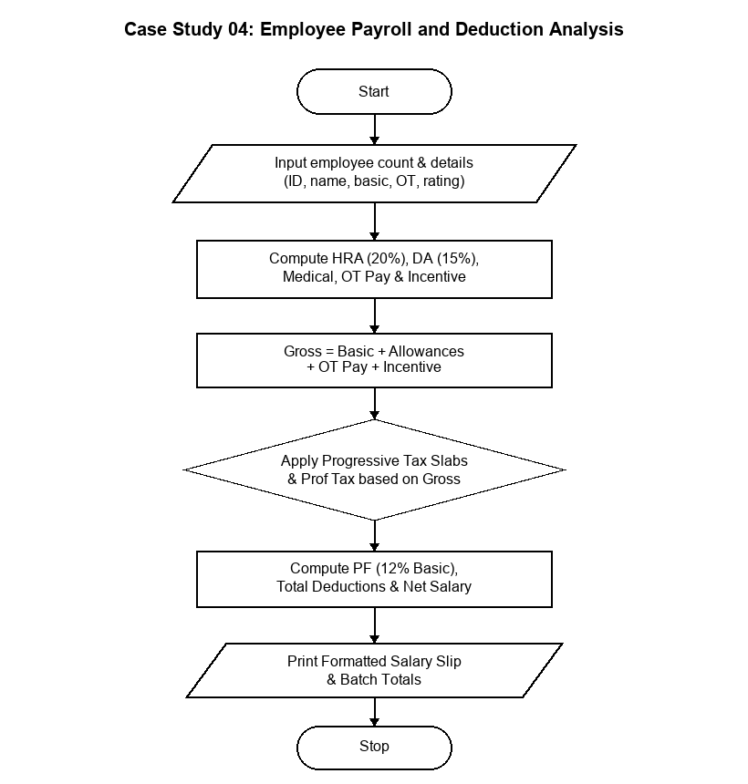
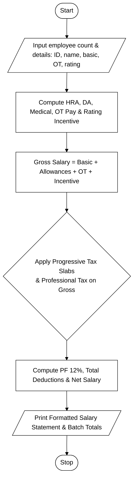
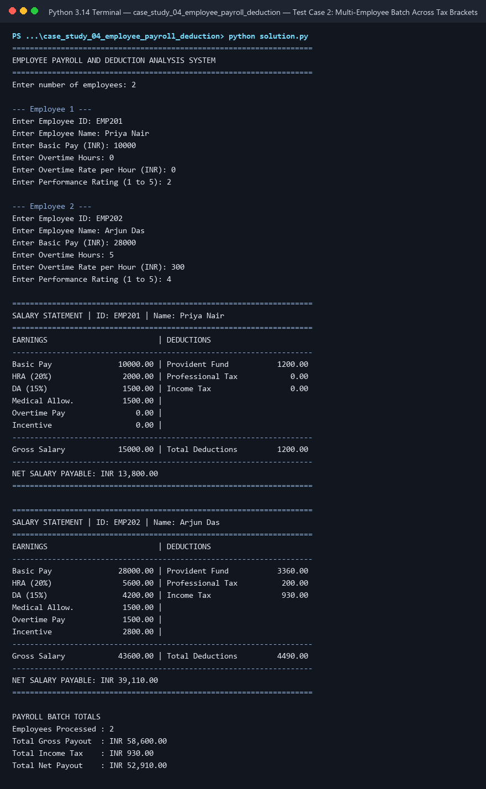
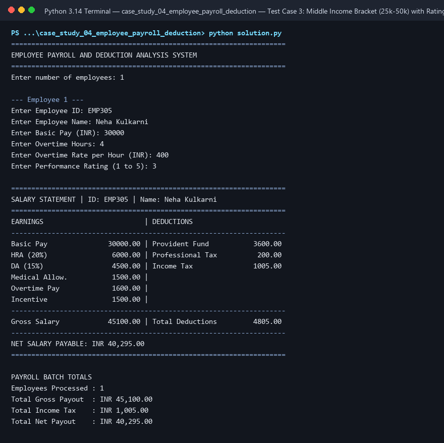

# Case Study 4: Employee Payroll and Deduction Analysis

- **Student Roll Number:** `26000639`
- **Source Code:** [solution.py](./solution.py)
- **Standalone Files:** [algorithm.md](./algorithm.md) | [pseudocode.md](./pseudocode.md) | [flowchart.png](./flowchart.png)
- **Syllabus Concepts Used:** Computational thinking, algorithms, flowcharts, pseudocode, variables, data types, operators, conditional statements, loops, strings, lists, tuples, unpacking.

---

## 1. Problem Statement
Build a Python payroll system that calculates each employee's gross salary from basic pay, allowances, overtime pay, and performance incentives; applies progressive statutory and tax deductions; and prints a formatted salary statement along with batch totals.

## 2. Objectives
- Compute earnings components (HRA, DA, Medical Allowance, Overtime, Performance Incentive).
- Apply tiered professional tax and progressive marginal income tax slabs.
- Store payroll records as tuples and unpack them to render aligned salary statements.
- Summarize batch payroll totals (employees processed, total gross, total tax, total net payout).

## 3. Assumptions
- Allowances: `HRA = 20%` of Basic Pay, `DA = 15%` of Basic Pay, `Medical Allowance = INR 1,500.00`.
- Incentive by rating: Rating `5` -> `15%` of Basic; Rating `4` -> `10%`; Rating `3` -> `5%`; otherwise `0%`.
- Deductions:
  - Provident Fund (`PF`) = `12%` of Basic Pay.
  - Professional Tax: `INR 0` (`Gross <= 15,000`), `INR 150` (`15,001–30,000`), `INR 200` (`> 30,000`).
  - Progressive Monthly Income Tax: `0%` up to `25,000`; `5%` on `25,001–50,000`; `10%` on `50,001–80,000`; `20%` above `80,000`.

## 4. Algorithm
1. **Start** and input `num_employees`.
2. For each employee `i` from `1` to `num_employees`:
   - Read `emp_id`, `emp_name`, `basic_pay`, `overtime_hrs`, `overtime_rate`, and `rating`.
   - Compute `hra`, `da`, `medical`, `overtime_pay`, and `incentive`, then sum them with `basic_pay` to get `gross_salary`.
   - Compute `pf = basic_pay * 0.12`, `prof_tax`, and slab-wise `income_tax`.
   - Compute `total_deductions` and `net_salary = gross_salary - total_deductions`.
   - Append the 14-field employee tuple to `payroll_records`.
3. Iterate over `payroll_records`, unpack each tuple, accumulate batch totals, and print the formatted side-by-side Earnings/Deductions salary slip.
4. Print batch payroll totals and **Stop**.

## 5. Flowchart





## 6. Pseudocode
```text
BEGIN
    INPUT num_employees
    SET payroll_records = []
    FOR i = 1 TO num_employees DO
        INPUT emp_id, emp_name, basic_pay, ot_hrs, ot_rate, rating
        hra = 0.20 * basic_pay
        da = 0.15 * basic_pay
        medical = 1500
        ot_pay = ot_hrs * ot_rate
        Determine incentive from rating (5->15%, 4->10%, 3->5%, else 0%)
        gross = basic_pay + hra + da + medical + ot_pay + incentive
        pf = 0.12 * basic_pay
        Determine prof_tax and progressive income_tax from gross
        deductions = pf + prof_tax + income_tax
        net = gross - deductions
        APPEND (emp_id, emp_name, ..., net) TO payroll_records
    END FOR
    FOR EACH record IN payroll_records DO
        Unpack record and PRINT formatted salary slip
        Accumulate batch gross, tax, and net totals
    END FOR
    PRINT batch totals
END
```

## 7. Test Cases

| Test Case | Scenario | Key Inputs | Expected Outcome | Status |
| :--- | :--- | :--- | :--- | :--- |
| **TC 1** | High earner in top `>80k` tax slab with Rating 5 | `EMP101`, Basic `60000`, OT `10 x 500`, Rating `5` | Gross `96,500.00`, PF `7200.00`, Income Tax `7550.00`, Net `INR 81,550.00` | Passed |
| **TC 2** | Multi-employee batch across zero-tax & 5% brackets | `EMP201` (Basic `10000`, Rating `2`), `EMP202` (Basic `28000`, OT `5x300`, Rating `4`) | `EMP201` Net `13,800.00` (Tax `0.00`); `EMP202` Net `39,110.00` (Tax `930.00`); Batch Net `INR 52,910.00` | Passed |
| **TC 3** | Middle income bracket (`25k–50k`) with Rating 3 | `EMP305`, Basic `30000`, OT `4 x 400`, Rating `3` | Gross `45,100.00`, Tax `1005.00`, Total Deductions `4805.00`, Net `INR 40,295.00` | Passed |

## 8. Output Screenshots

### Test Case 1


### Test Case 2


### Test Case 3


## 9. Conclusion
The Employee Payroll and Deduction Analysis system automates gross-to-net salary computation using progressive tax brackets, cleanly formats professional payslips via string formatting, and summarizes organization-wide payroll totals.
