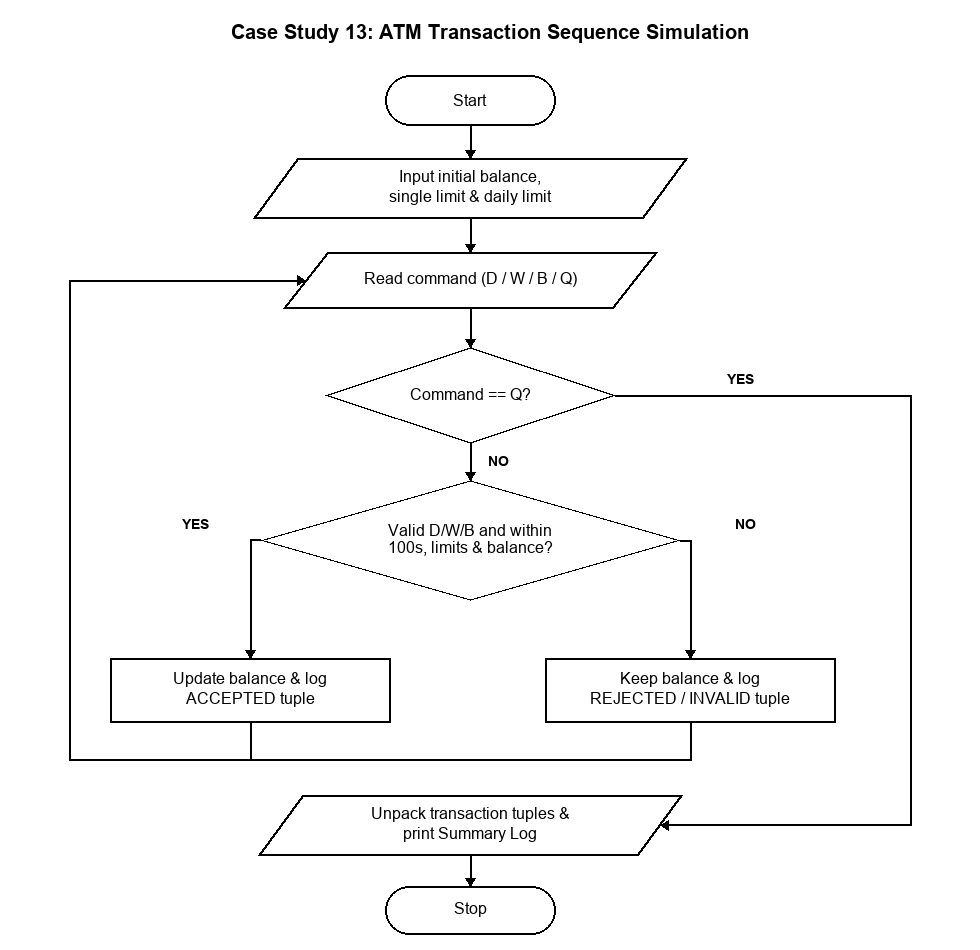
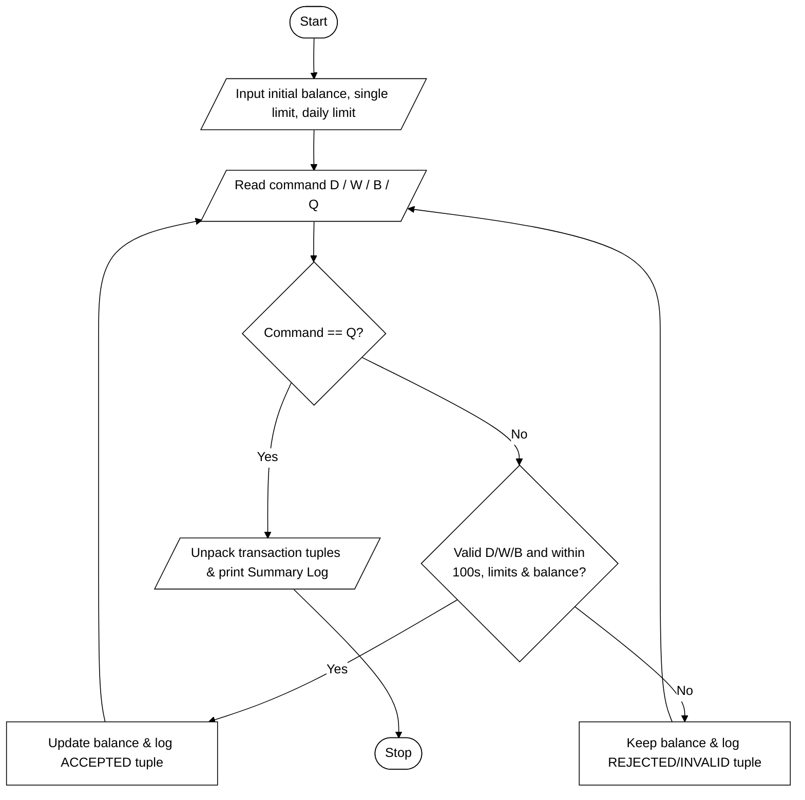
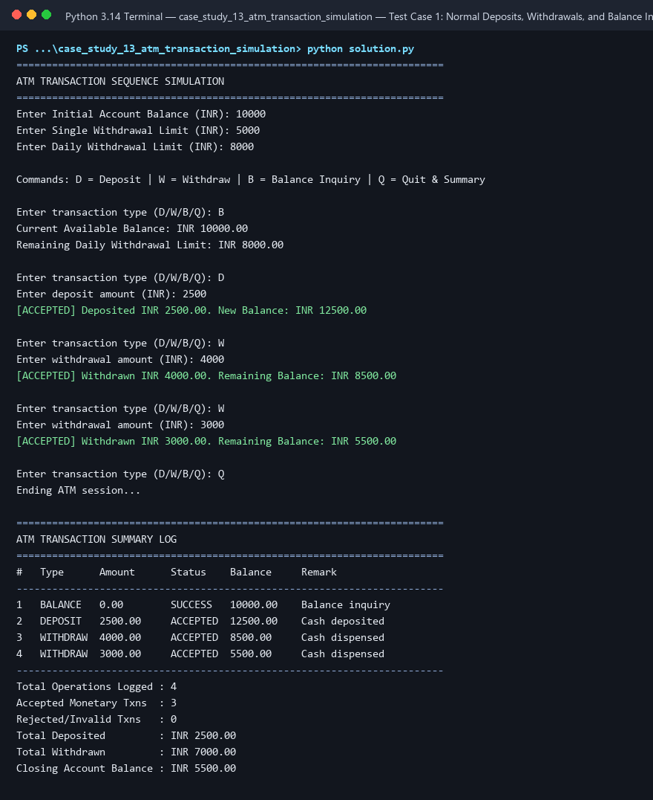
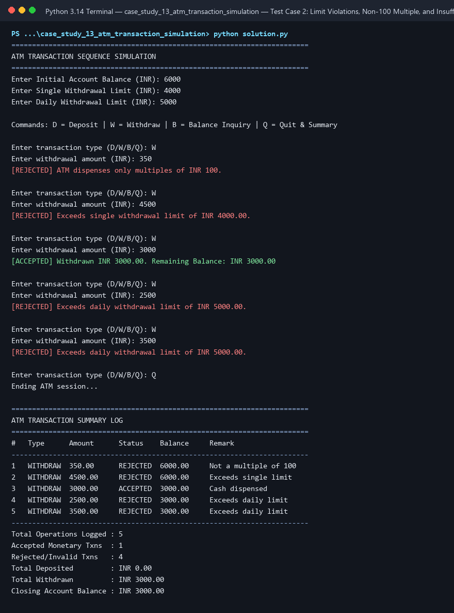
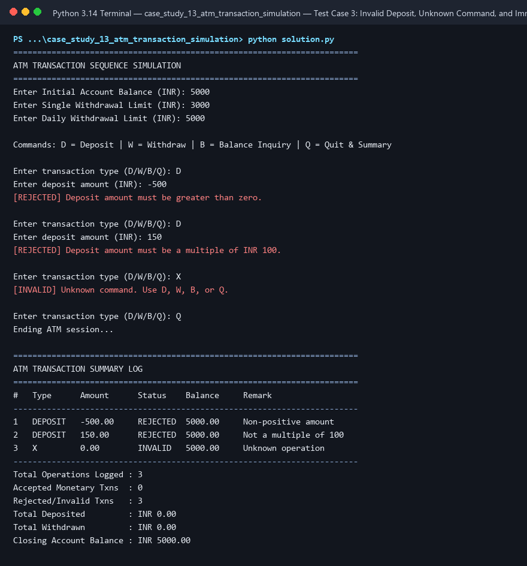

# Case Study 13: ATM Transaction Sequence Simulation

- **Student Roll Number:** `26000639`
- **Source Code:** [solution.py](./solution.py)
- **Standalone Files:** [algorithm.md](./algorithm.md) | [pseudocode.md](./pseudocode.md) | [flowchart.png](./flowchart.png)
- **Syllabus Concepts Used:** Computational thinking, algorithms, flowcharts, pseudocode, variables, data types, operators, conditional statements, loops, strings, lists, tuples, unpacking.

---

## 1. Problem Statement
Simulate an ATM transaction processor that handles a sequence of deposits, withdrawals, and balance inquiries while maintaining a running account balance, enforcing single-transaction and daily withdrawal limits, rejecting invalid operations, and generating a detailed transaction summary log.

## 2. Objectives
- Maintain running `balance` and `daily_withdrawn` state across an interactive `while` loop.
- Enforce banking rules: positive amounts, multiples of `INR 100`, single withdrawal limit, daily withdrawal limit, and sufficient balance.
- Record every accepted, rejected, and invalid operation as an immutable tuple.
- Unpack logged tuples at session exit to print a complete audit table and totals.

## 3. Assumptions
- Both deposits and withdrawals must be positive multiples of `INR 100`.
- Valid commands are `D` (Deposit), `W` (Withdraw), `B` (Balance Inquiry), and `Q` (Quit & Summary), case-insensitive.
- Rejected or unknown commands are logged in the audit trail without modifying the balance.

## 4. Algorithm
1. **Start** and input `balance`, `single_limit`, and `daily_limit`.
2. Initialize `daily_withdrawn = 0.0`, `transactions = []`, and `tx_no = 1`.
3. Repeat in a `while True` loop:
   - Read and normalize `choice`.
   - If `choice == "Q"`, break out of loop.
   - If `choice == "B"`, display current balance and remaining daily limit; append log tuple.
   - If `choice == "D"`, validate `amt > 0` and `amt % 100 == 0`; update `balance` if valid, else reject; append log tuple.
   - If `choice == "W"`, validate `amt > 0`, `amt % 100 == 0`, `amt <= single_limit`, `daily_withdrawn + amt <= daily_limit`, and `amt <= balance`; deduct and update `daily_withdrawn` if valid, else reject; append log tuple.
   - Otherwise, report `[INVALID]` command and append log tuple.
4. Loop over `transactions`, unpack each tuple, print the formatted log table, and compute summary totals.
5. **Stop**.

## 5. Flowchart





## 6. Pseudocode
```text
BEGIN
    INPUT balance, single_limit, daily_limit
    SET daily_withdrawn = 0, transactions = [], tx_no = 1
    WHILE TRUE DO
        INPUT choice (uppercase)
        IF choice == "Q" THEN BREAK
        ELSE IF choice == "B" THEN
            PRINT balance, daily_limit - daily_withdrawn
            APPEND (tx_no, "BALANCE", 0, "SUCCESS", balance, "Balance inquiry") TO transactions
        ELSE IF choice == "D" THEN
            INPUT amt
            IF amt > 0 AND amt MOD 100 == 0 THEN
                balance = balance + amt
                APPEND (tx_no, "DEPOSIT", amt, "ACCEPTED", balance, "Cash deposited") TO transactions
            ELSE
                APPEND (tx_no, "DEPOSIT", amt, "REJECTED", balance, reason) TO transactions
            END IF
        ELSE IF choice == "W" THEN
            INPUT amt
            Validate > 0, multiple of 100, <= single_limit, daily_withdrawn + amt <= daily_limit, <= balance
            Update balance and daily_withdrawn if valid; log ACCEPTED or REJECTED
        ELSE
            APPEND (tx_no, choice, 0, "INVALID", balance, "Unknown operation") TO transactions
        END IF
        tx_no = tx_no + 1
    END WHILE
    Unpack transactions and PRINT summary table and totals
END
```

## 7. Test Cases

| Test Case | Scenario | Key Inputs | Expected Outcome | Status |
| :--- | :--- | :--- | :--- | :--- |
| **TC 1** | Normal sequence (`B`, `D`, `W`, `W`, `Q`) | Init `10000`, Single `5000`, Daily `8000`; `B`, `D 2500`, `W 4000`, `W 3000`, `Q` | 4 operations logged, 3 monetary txns accepted, total deposited `2500.00`, withdrawn `7000.00`, closing `INR 5500.00` | Passed |
| **TC 2** | Denomination, single limit, and daily limit rejections | Init `6000`, Single `4000`, Daily `5000`; `W 350`, `W 4500`, `W 3000`, `W 2500`, `W 3500`, `Q` | Only `W 3000` accepted; others rejected with exact reasons; closing `INR 3000.00` | Passed |
| **TC 3** | Negative deposit, non-100 deposit, and unknown command | Init `5000`, `D -500`, `D 150`, `X`, `Q` | All 3 logged as `REJECTED`/`INVALID`; `0` accepted; closing balance unchanged at `INR 5000.00` | Passed |

## 8. Output Screenshots

### Test Case 1


### Test Case 2


### Test Case 3


## 9. Conclusion
The ATM Transaction Sequence Simulation demonstrates stateful loop processing, defensive multi-condition validation, and immutable audit logging via tuples and tuple unpacking.
