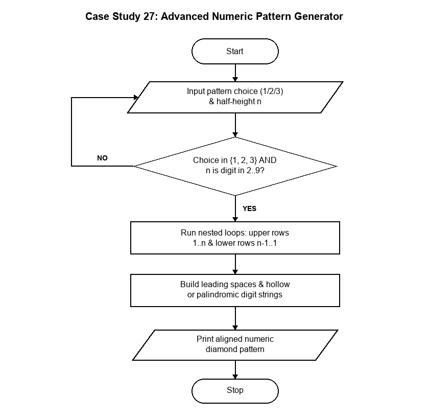
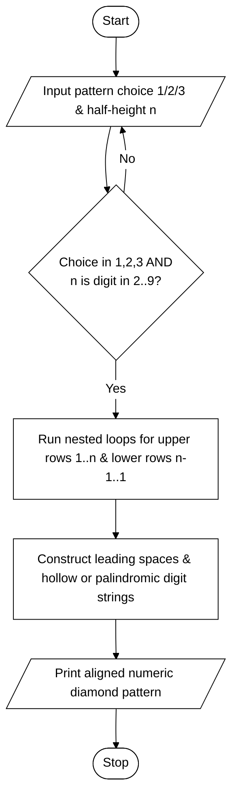
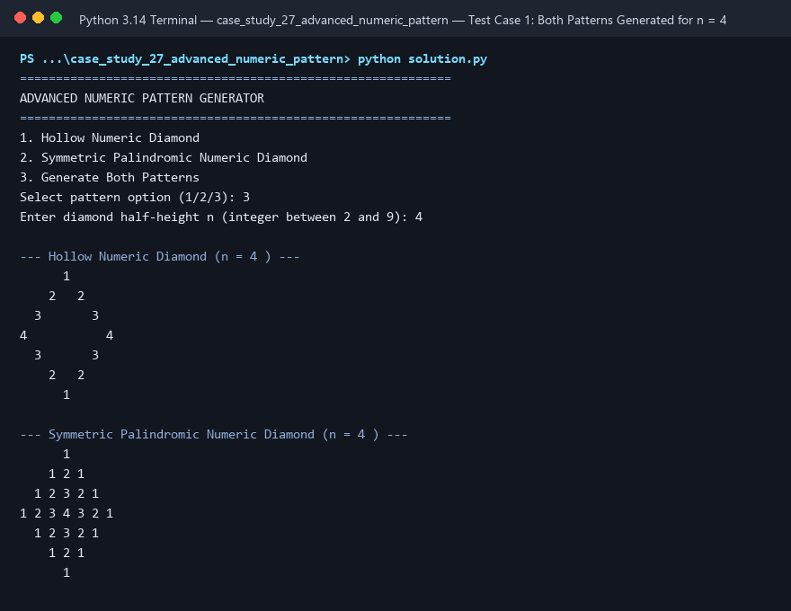
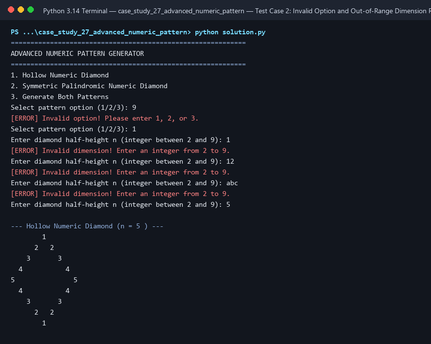
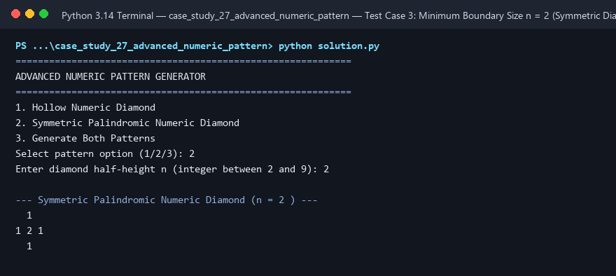

# Case Study 27: Advanced Numeric Pattern Generator

- **Student Roll Number:** `26000639`
- **Source Code:** [solution.py](./solution.py)
- **Standalone Files:** [algorithm.md](./algorithm.md) | [pseudocode.md](./pseudocode.md) | [flowchart.png](./flowchart.png)
- **Syllabus Concepts Used:** Computational thinking, algorithms, flowcharts, pseudocode, variables, data types, operators, conditional statements, loops, strings, pattern generation.

---

## 1. Problem Statement
Create an Advanced Numeric Pattern Generator that produces either a hollow numeric diamond, a symmetric palindromic numeric diamond, or both, based on user-specified dimensions, while validating invalid menu choices and dimensions and preserving clean alignment.

## 2. Objectives
- Validate both menu selection (`1`, `2`, `3`) and diamond half-height `n` (`2 <= n <= 9`) using `while` loops and `.isdigit()`.
- Construct symmetric upper and lower half diamond rows using nested `for` loops.
- Align multi-row numeric output cleanly using leading spaces and `.rstrip()`.

## 3. Assumptions
- Half-height `n` is restricted to integers from `2` to `9` so every digit remains single-width (`1–9`) for perfect symmetry.
- Non-numeric inputs (e.g., `"abc"`) and out-of-range numbers (`< 2` or `> 9`) are rejected and re-prompted cleanly without crashing.

## 4. Algorithm
1. **Start** and display the pattern menu (`1`: Hollow Diamond, `2`: Palindromic Diamond, `3`: Both).
2. Read `choice`; loop while `choice` is not `"1"`, `"2"`, or `"3"`.
3. Read `raw_n`; loop while `raw_n` is not digits or `int(raw_n) < 2` or `int(raw_n) > 9`, then set `n = int(raw_n)`.
4. If `choice` is `"1"` or `"3"`:
   - Loop `i` from `1` to `n` (upper half) and `n - 1` down to `1` (lower half):
     - Append `n - i` double spaces, then print `i` only at boundary positions (`j == 1` or `j == 2*i - 1`) and spaces inside.
5. If `choice` is `"2"` or `"3"`:
   - Loop `i` from `1` to `n` and `n - 1` down to `1`:
     - Append `n - i` double spaces, ascending digits `1..i`, and descending digits `i-1..1`.
6. **Stop**.

## 5. Flowchart





## 6. Pseudocode
```text
BEGIN
    INPUT choice
    WHILE choice NOT IN ("1", "2", "3") DO
        PRINT "Invalid option"
        INPUT choice
    END WHILE
    INPUT raw_n
    WHILE NOT ISDIGIT(raw_n) OR INT(raw_n) < 2 OR INT(raw_n) > 9 DO
        PRINT "Invalid dimension"
        INPUT raw_n
    END WHILE
    n = INT(raw_n)
    IF choice == "1" OR choice == "3" THEN
        FOR i = 1 TO n AND n-1 DOWNTO 1 DO
            Print (n - i) * "  " + hollow row with i at ends
        END FOR
    END IF
    IF choice == "2" OR choice == "3" THEN
        FOR i = 1 TO n AND n-1 DOWNTO 1 DO
            Print (n - i) * "  " + "1..i..1"
        END FOR
    END IF
END
```

## 7. Test Cases

| Test Case | Scenario | Key Inputs | Expected Outcome | Status |
| :--- | :--- | :--- | :--- | :--- |
| **TC 1** | Both diamond patterns for `n = 4` | Option `3`, Size `4` | Prints 7-row Hollow Numeric Diamond (`1..4..1`) and 7-row Symmetric Palindromic Diamond (`1 2 3 4 3 2 1`) | Passed |
| **TC 2** | Invalid option & dimension recovery (`1`, `12`, `abc` -> `5`) | Option `9 -> 1`, Size `1 -> 12 -> abc -> 5` | Prints `[ERROR]` prompts for each invalid input, then renders 9-row Hollow Diamond for `n = 5` | Passed |
| **TC 3** | Minimum boundary dimension `n = 2` | Option `2`, Size `2` | Prints compact 3-row Palindromic Diamond (`1` / `1 2 1` / `1`) | Passed |

## 8. Output Screenshots

### Test Case 1


### Test Case 2


### Test Case 3


## 9. Conclusion
The Advanced Numeric Pattern Generator reinforces nested loop indexing, string-based alignment, and safe input validation using string predicates without relying on exception handling.
