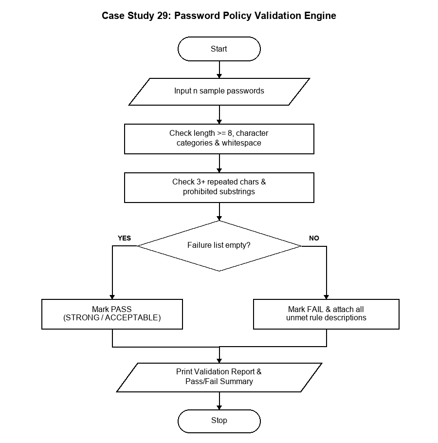
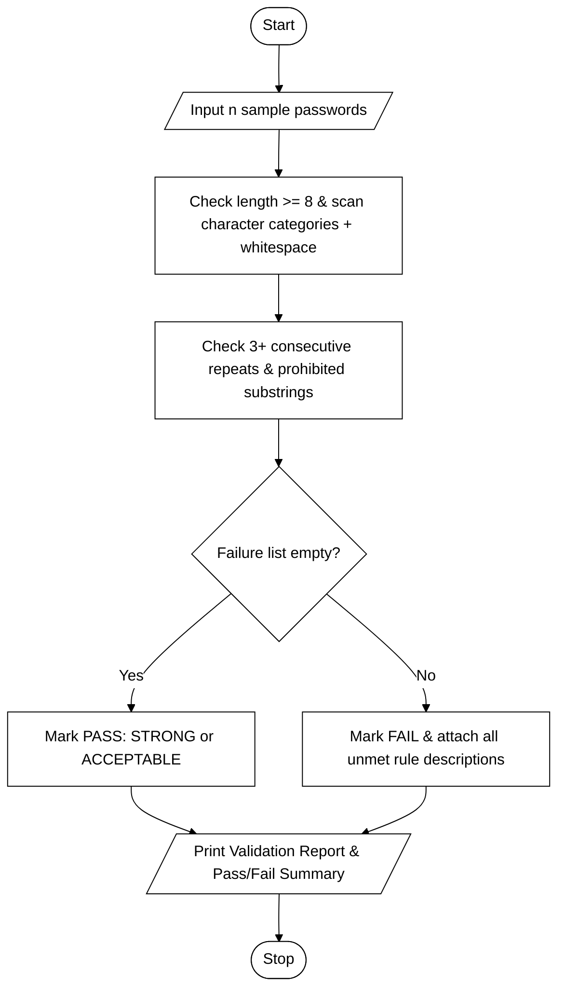
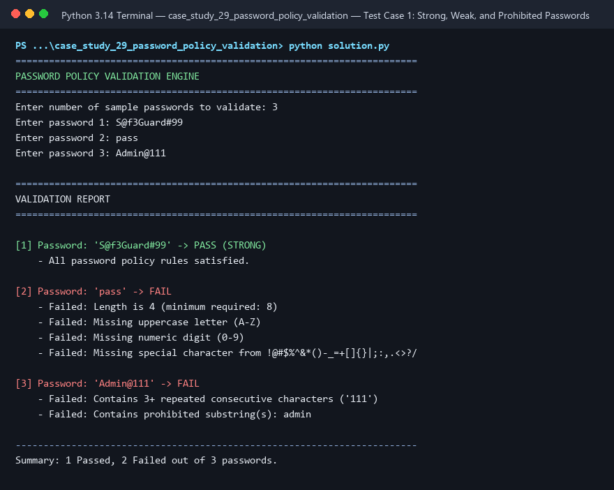
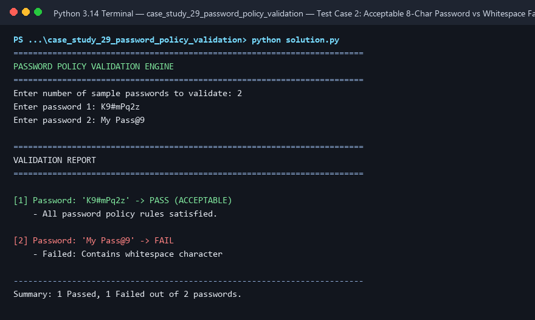
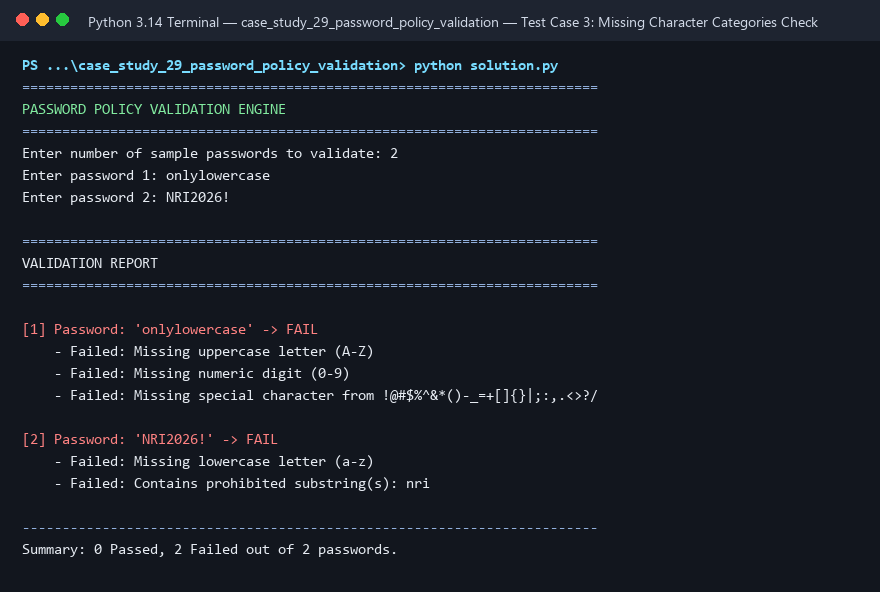

# Case Study 29: Password Policy Validation Engine

- **Student Roll Number:** `26000639`
- **Source Code:** [solution.py](./solution.py)
- **Standalone Files:** [algorithm.md](./algorithm.md) | [pseudocode.md](./pseudocode.md) | [flowchart.png](./flowchart.png)
- **Syllabus Concepts Used:** Computational thinking, algorithms, flowcharts, pseudocode, variables, data types, operators, conditional statements, loops, strings, lists, tuples, unpacking.

---

## 1. Problem Statement
Design a Password Policy Validation Engine that evaluates sample password strings against minimum length, character-category diversity (uppercase, lowercase, digits, special characters, no spaces), consecutive character repetition limits, and prohibited substring rules, explaining every failed condition for each password.

## 2. Objectives
- Evaluate every policy condition independently so users receive complete diagnostic feedback rather than failing on the first error alone.
- Inspect character categories using string methods (`.isupper()`, `.islower()`, `.isdigit()`, membership `in`).
- Detect runs of `3` or more identical consecutive characters via string slicing/indexing.
- Perform case-insensitive prohibited substring detection using `.lower()`.

## 3. Assumptions
- Minimum password length is `8` characters (`>= 12` rated `STRONG`, `8–11` rated `ACCEPTABLE`).
- Allowed special characters set: `!@#$%^&*()-_=+[]{}|;:,.<>?/`.
- Whitespace (`" "` or `"\t"`) is prohibited.
- Prohibited substrings list: `["password", "1234", "admin", "qwerty", "nri", "welcome"]`.

## 4. Algorithm
1. **Start** and input `n` sample passwords into list `passwords`.
2. For each `pwd` in `passwords`:
   - Initialize `failures = []` and boolean flags `has_upper`, `has_lower`, `has_digit`, `has_special`, `has_space`.
   - Check `len(pwd) < 8`; if true, append failure reason.
   - Loop through each character `ch` in `pwd` to update the five boolean flags; append reasons for any unmet character requirement or whitespace.
   - Loop `i` from `0` to `len(pwd) - 3` to detect `pwd[i] == pwd[i+1] == pwd[i+2]`; if found, append repetition failure.
   - Check each banned word in `PROHIBITED_SUBSTRINGS` against `pwd.lower()`; if matched, append prohibited substring failure.
   - Store `(pwd, status, failures)` tuple in `results`.
3. Loop through `results`, unpack each tuple, print pass/fail status with all unmet rules, and print the overall pass/fail summary.
4. **Stop**.

## 5. Flowchart





## 6. Pseudocode
```text
BEGIN
    INPUT n
    INPUT n strings INTO passwords
    SET results = [], passed_count = 0
    FOR EACH pwd IN passwords DO
        SET failures = []
        IF LENGTH(pwd) < 8 THEN APPEND length failure TO failures
        Scan characters for upper, lower, digit, special, space
        APPEND failures for any missing category or space found
        FOR i = 0 TO LENGTH(pwd) - 3 DO
            IF pwd[i] == pwd[i+1] AND pwd[i+1] == pwd[i+2] THEN
                APPEND repetition failure TO failures
                BREAK
            END IF
        END FOR
        Check each banned word IN LOWER(pwd)
        IF LENGTH(failures) == 0 THEN
            passed_count = passed_count + 1
            APPEND (pwd, "PASS", failures) TO results
        ELSE
            APPEND (pwd, "FAIL", failures) TO results
        END IF
    END FOR
    PRINT validation report and summary
END
```

## 7. Test Cases

| Test Case | Scenario | Key Inputs | Expected Outcome | Status |
| :--- | :--- | :--- | :--- | :--- |
| **TC 1** | Mix of strong, short/weak, and repeated+banned passwords | `S@f3Guard#99`, `pass`, `Admin@111` | `S@f3Guard#99` -> `PASS (STRONG)`; `pass` -> `FAIL` (4 rules); `Admin@111` -> `FAIL` (`111` repeat & `admin`) | Passed |
| **TC 2** | 8-char acceptable password vs space-containing password | `K9#mPq2z`, `My Pass@9` | `K9#mPq2z` -> `PASS (ACCEPTABLE)`; `My Pass@9` -> `FAIL` (whitespace) | Passed |
| **TC 3** | Missing character categories & prohibited `nri` substring | `onlylowercase`, `NRI2026!` | `onlylowercase` fails upper/digit/special; `NRI2026!` fails missing lowercase & prohibited `nri` | Passed |

## 8. Output Screenshots

### Test Case 1


### Test Case 2


### Test Case 3


## 9. Conclusion
The Password Policy Validation Engine demonstrates comprehensive string inspection using character predicates, sliding-window indexing, and multi-rule diagnostic reporting without short-circuiting user feedback.
