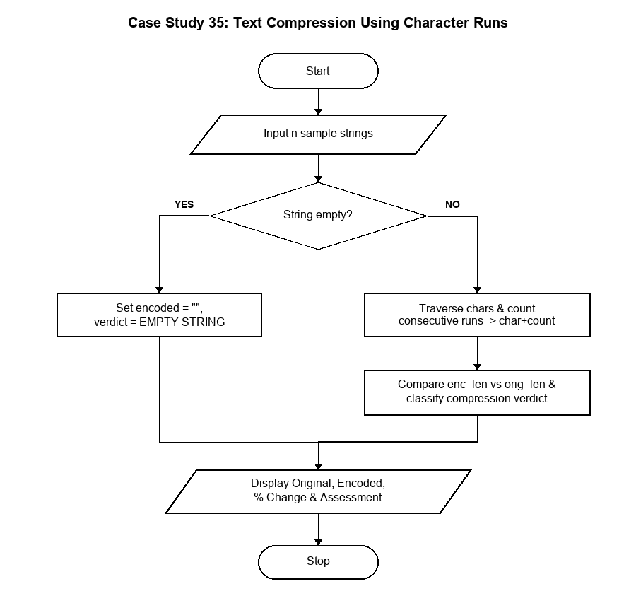
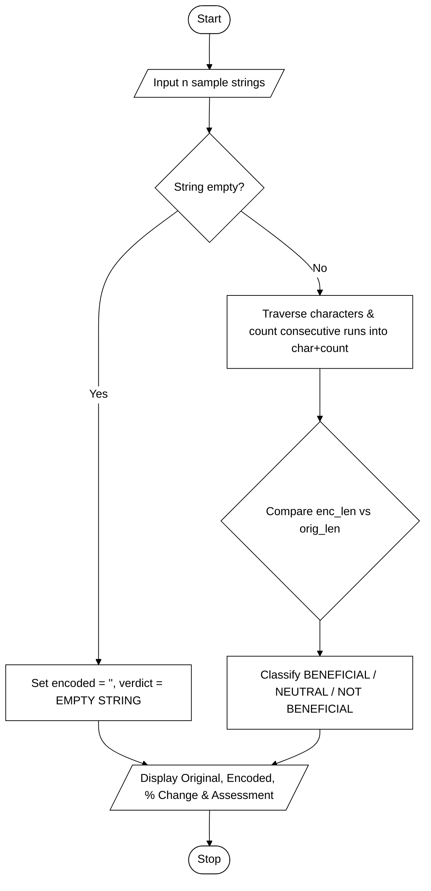
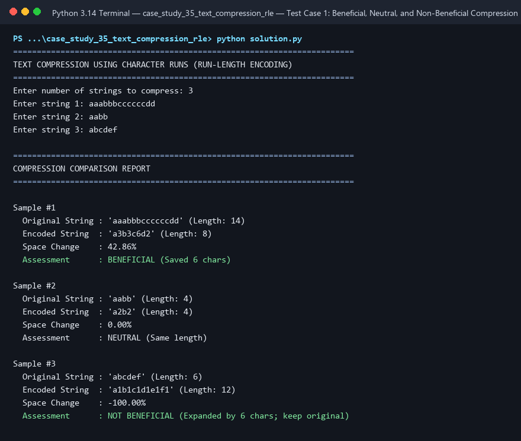
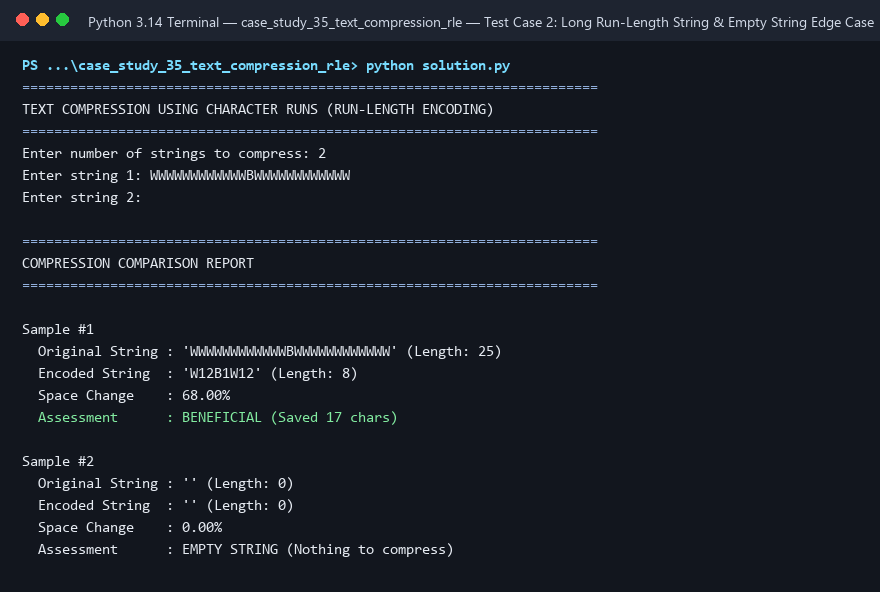
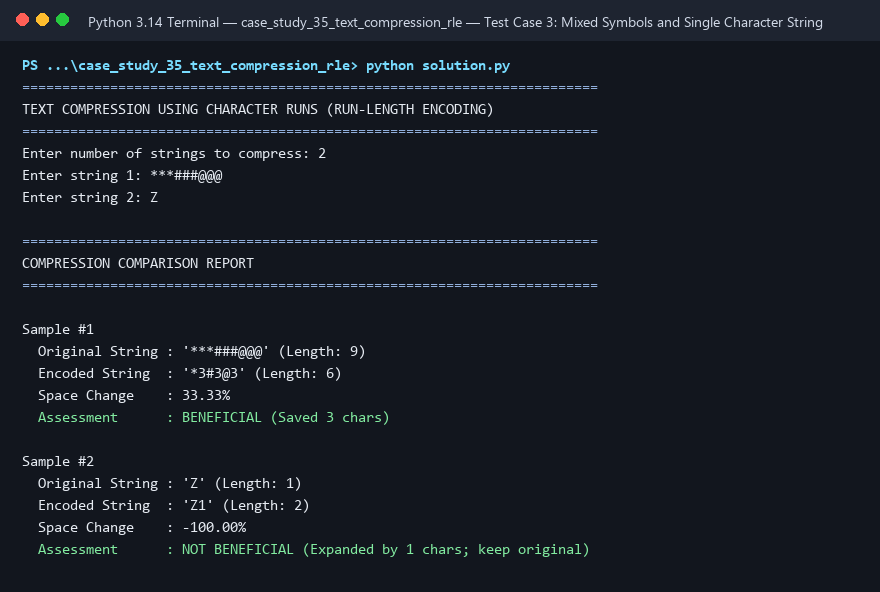

# Case Study 35: Text Compression Using Character Runs

- **Student Roll Number:** `26000639`
- **Source Code:** [solution.py](./solution.py)
- **Standalone Files:** [algorithm.md](./algorithm.md) | [pseudocode.md](./pseudocode.md) | [flowchart.png](./flowchart.png)
- **Syllabus Concepts Used:** Computational thinking, algorithms, flowcharts, pseudocode, variables, data types, operators, conditional statements, loops, strings, lists, tuples, unpacking.

---

## 1. Problem Statement
Implement Run-Length Encoding (RLE) in Python to compress strings by grouping consecutive repeated characters into `<char><count>` pairs, then compare the original and encoded string lengths to evaluate whether encoding is beneficial, neutral, or counterproductive.

## 2. Objectives
- Traverse strings sequentially to group consecutive identical character runs.
- Handle edge cases cleanly, including empty strings (`""`) and single-character strings.
- Compute space savings percentage `((orig_len - enc_len) / orig_len) * 100`.
- Classify each sample as `BENEFICIAL`, `NEUTRAL`, `NOT BENEFICIAL`, or `EMPTY STRING`.

## 3. Assumptions
- Each character run is encoded as the character followed by its decimal run length (e.g., `aaa` -> `a3`, `B` -> `B1`).
- Case sensitivity is preserved (`'A'` and `'a'` are distinct runs).
- Empty input strings produce `""` with `0.00%` change.

## 4. Algorithm
1. **Start** and read `n` sample strings into `samples`.
2. For each `text` in `samples`:
   - Set `orig_len = len(text)`.
   - If `orig_len == 0`, set `encoded = ""`, `enc_len = 0`, `verdict = "EMPTY STRING"`.
   - Else:
     - Initialize `encoded = ""`, `current_char = text[0]`, `run_count = 1`.
     - Loop `i` from `1` to `orig_len - 1`: if `text[i] == current_char`, increment `run_count`; else append `current_char + str(run_count)` to `encoded`, reset `current_char = text[i]` and `run_count = 1`.
     - Append the final run `current_char + str(run_count)` to `encoded`.
     - Compute `enc_len = len(encoded)` and `savings_pct`.
     - Classify as `BENEFICIAL` (`enc_len < orig_len`), `NEUTRAL` (`enc_len == orig_len`), or `NOT BENEFICIAL` (`enc_len > orig_len`).
   - Store `(text, orig_len, encoded, enc_len, round(savings_pct, 2), verdict)` in `results`.
3. Unpack `results` and print the formatted comparison report.
4. **Stop**.

## 5. Flowchart





## 6. Pseudocode
```text
BEGIN
    INPUT n
    INPUT n strings INTO samples
    SET results = []
    FOR EACH text IN samples DO
        orig_len = LENGTH(text)
        IF orig_len == 0 THEN
            APPEND ("", 0, "", 0, 0.0, "EMPTY STRING") TO results
        ELSE
            encoded = ""
            current_char = text[0], run_count = 1
            FOR i = 1 TO orig_len - 1 DO
                IF text[i] == current_char THEN
                    run_count = run_count + 1
                ELSE
                    encoded = encoded + current_char + STR(run_count)
                    current_char = text[i]
                    run_count = 1
                END IF
            END FOR
            encoded = encoded + current_char + STR(run_count)
            enc_len = LENGTH(encoded)
            Compute savings_pct and classification
            APPEND (text, orig_len, encoded, enc_len, savings_pct, verdict) TO results
        END IF
    END FOR
    Unpack results and PRINT comparison report
END
```

## 7. Test Cases

| Test Case | Scenario | Key Inputs | Expected Outcome | Status |
| :--- | :--- | :--- | :--- | :--- |
| **TC 1** | Beneficial, neutral, and non-beneficial runs | `aaabbbccccccdd`, `aabb`, `abcdef` | `a3b3c6d2` (`42.86%` `BENEFICIAL`), `a2b2` (`0.00%` `NEUTRAL`), `a1b1c1d1e1f1` (`-100.00%` `NOT BENEFICIAL`) | Passed |
| **TC 2** | Long run-length string & empty string edge case | `WWWWWWWWWWWWBWWWWWWWWWWWW`, `""` | `W12B1W12` (`68.00%` `BENEFICIAL`, saved 17 chars); empty string handled cleanly | Passed |
| **TC 3** | Mixed symbols & single character string | `***###@@@`, `Z` | `*3#3@3` (`33.33%` `BENEFICIAL`); `Z1` (`-100.00%` `NOT BENEFICIAL`) | Passed |

## 8. Output Screenshots

### Test Case 1


### Test Case 2


### Test Case 3


## 9. Conclusion
The Text Compression Using Character Runs program illustrates how simple linear string traversal achieves lossless compression on repetitive data while clearly showing why Run-Length Encoding expands non-repetitive text.
