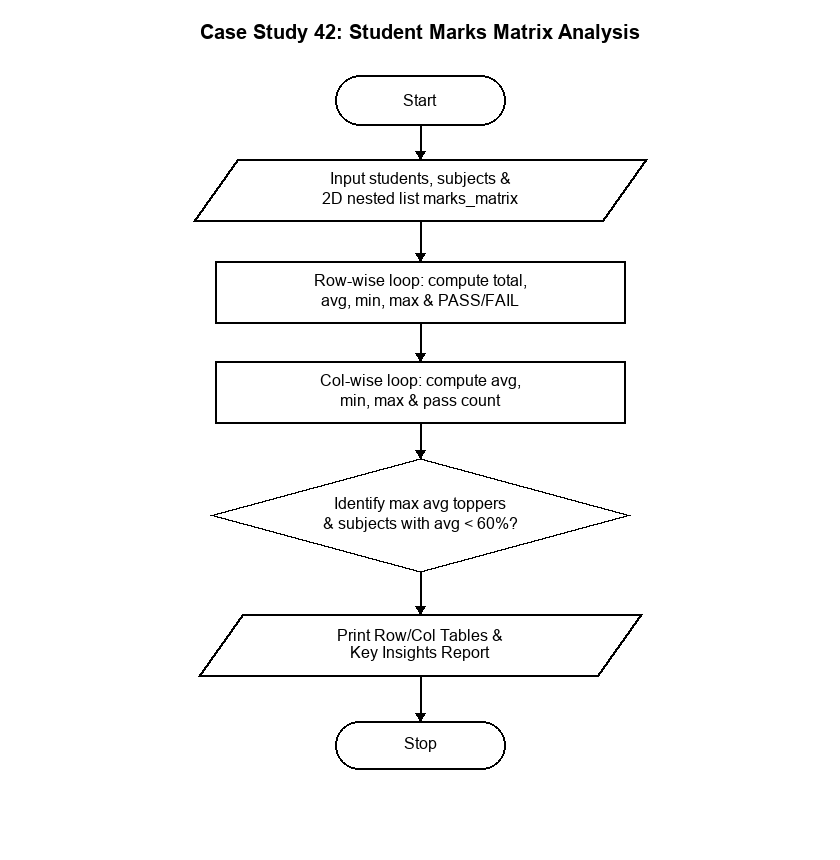
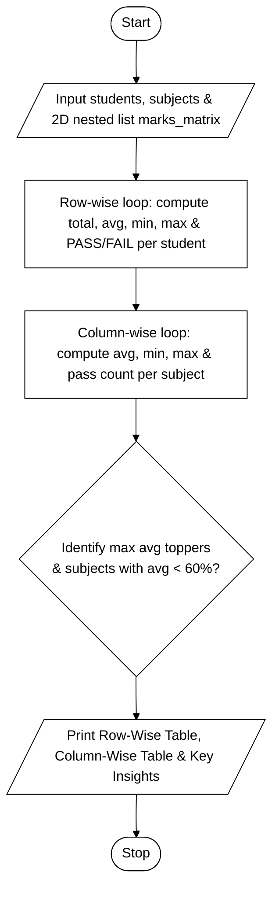
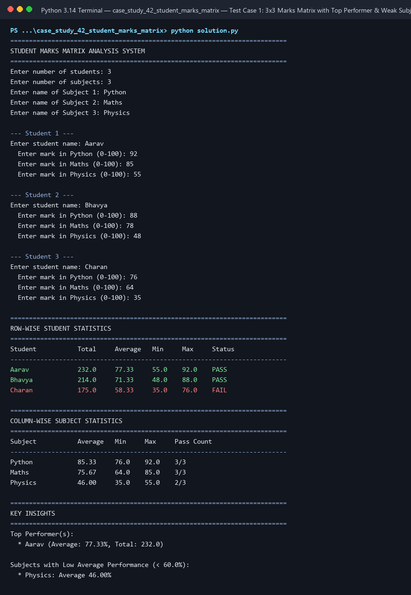
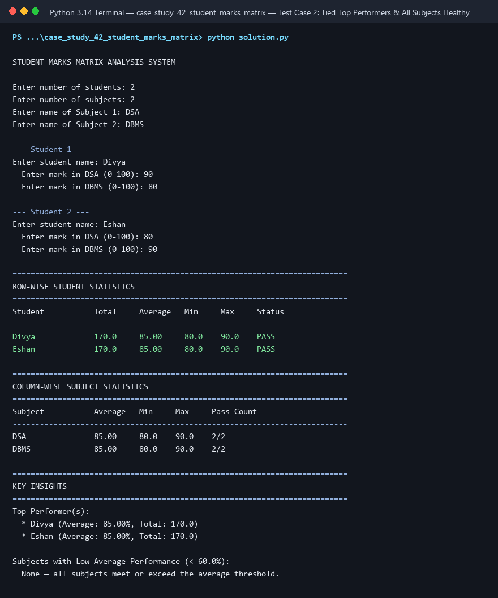
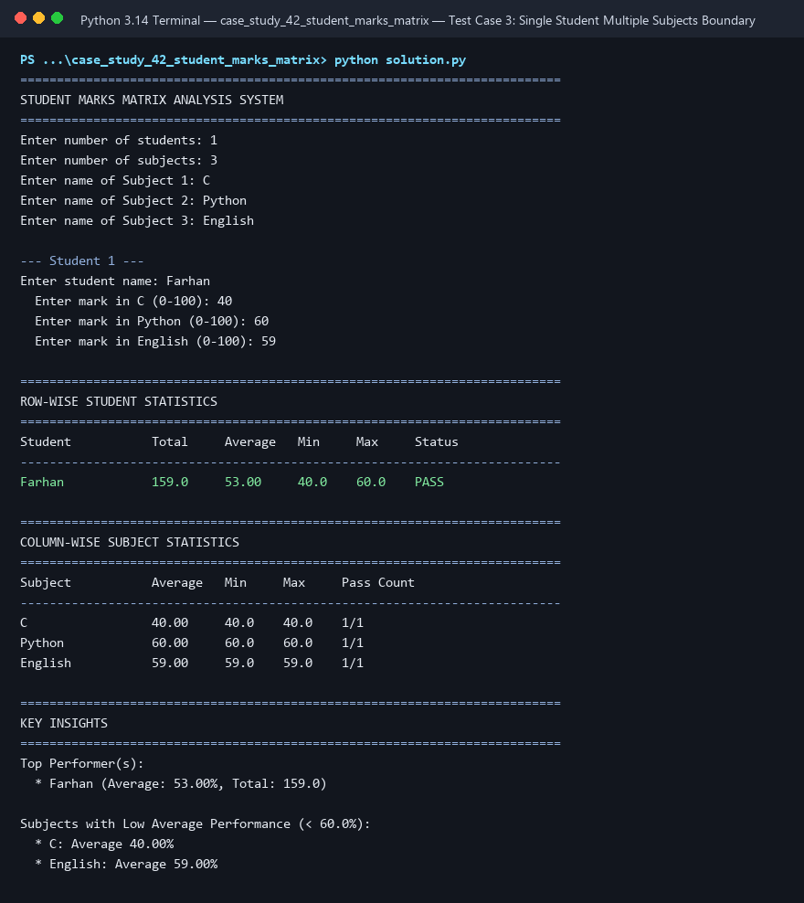

# Case Study 42: Student Marks Matrix Analysis

- **Student Roll Number:** `26000639`
- **Source Code:** [solution.py](./solution.py)
- **Standalone Files:** [algorithm.md](./algorithm.md) | [pseudocode.md](./pseudocode.md) | [flowchart.png](./flowchart.png)
- **Syllabus Concepts Used:** Computational thinking, algorithms, flowcharts, pseudocode, variables, data types, operators, conditional statements, loops, strings, lists, nested lists, tuples, unpacking.

---

## 1. Problem Statement
Build a Python application that stores student marks across multiple subjects in a 2D nested list (matrix), computes row-wise student statistics (total, average, min, max, pass/fail) and column-wise subject statistics (average, min, max, pass count), identifies top performers (including ties), and flags subjects with low average performance.

## 2. Objectives
- Represent tabular student-by-subject marks using a nested list `marks_matrix[i][j]`.
- Perform row-wise aggregations per student and column-wise aggregations per subject using nested loops.
- Detect tied top performers accurately using maximum average comparison.
- Identify subjects whose class average falls below `60.0%`.

## 3. Assumptions
- Subject passing mark is `40.0` out of `100` (a student's overall status is `PASS` only if all subject marks are `>= 40.0`).
- A subject is flagged as having low average performance if its mean score is strictly below `60.0%`.
- At least `1` student and `1` subject are provided.

## 4. Algorithm
1. **Start** and read `num_students`, `num_subjects`, and `subject_names`.
2. Loop `i` from `0` to `num_students - 1` to input each student's name and a nested list `row` of `num_subjects` marks; append `row` to `marks_matrix`.
3. **Row-wise analysis:** For each student `i`, compute `row_sum`, `row_avg`, `row_min`, `row_max`, and `passed_all`; track `highest_avg`; store student summary tuple in `student_stats`.
4. **Column-wise analysis:** For each subject `j`, loop across rows `0..num_students-1` to compute `col_avg`, `col_min`, `col_max`, and `pass_count`; append subject tuple to `subject_stats` and flag subjects with `col_avg < 60.0` into `low_avg_subjects`.
5. Collect all students whose `avg == highest_avg` into `top_performers`.
6. Print formatted Row-wise table, Column-wise table, Top Performer(s), and Low-Average Subjects.
7. **Stop**.

## 5. Flowchart





## 6. Pseudocode
```text
BEGIN
    INPUT num_students, num_subjects, subject_names
    SET student_names = [], marks_matrix = []
    FOR i = 0 TO num_students - 1 DO
        INPUT st_name, row[0..num_subjects-1]
        APPEND row TO marks_matrix
    END FOR
    SET highest_avg = -1, student_stats = []
    FOR i = 0 TO num_students - 1 DO
        Compute row_sum, row_avg, row_min, row_max, passed_all
        IF row_avg > highest_avg THEN highest_avg = row_avg
        APPEND (student_names[i], row_sum, row_avg, row_min, row_max, passed_all) TO student_stats
    END FOR
    SET subject_stats = [], low_avg_subjects = []
    FOR j = 0 TO num_subjects - 1 DO
        Compute col_avg, col_min, col_max, pass_count across rows
        APPEND (subject_names[j], col_avg, col_min, col_max, pass_count) TO subject_stats
        IF col_avg < 60.0 THEN APPEND (subject_names[j], col_avg) TO low_avg_subjects
    END FOR
    PRINT tables, top_performers (avg == highest_avg), low_avg_subjects
END
```

## 7. Test Cases

| Test Case | Scenario | Key Inputs | Expected Outcome | Status |
| :--- | :--- | :--- | :--- | :--- |
| **TC 1** | `3 x 3` matrix with top performer & weak subject | Aarav `(92,85,55)`, Bhavya `(88,78,48)`, Charan `(76,64,35)` | Aarav top performer (`77.33%`), Charan `FAIL` (`35 < 40`), `Physics` flagged (`46.00% < 60%`) | Passed |
| **TC 2** | Tied top performers & all healthy subjects | Divya `(90,80)`, Eshan `(80,90)` | Both Divya and Eshan listed as Top Performers (`85.00%`); no low-average subjects | Passed |
| **TC 3** | Single student boundary (`40` pass, `59` low avg) | Farhan: C `40`, Python `60`, English `59` | Overall `PASS` (`min=40`); `C (40.00%)` and `English (59.00%)` flagged `< 60.0%` | Passed |

## 8. Output Screenshots

### Test Case 1


### Test Case 2


### Test Case 3


## 9. Conclusion
The Student Marks Matrix Analysis program effectively uses nested lists for 2D tabular representation and nested loops for dual-axis (row-wise and column-wise) academic analytics.
