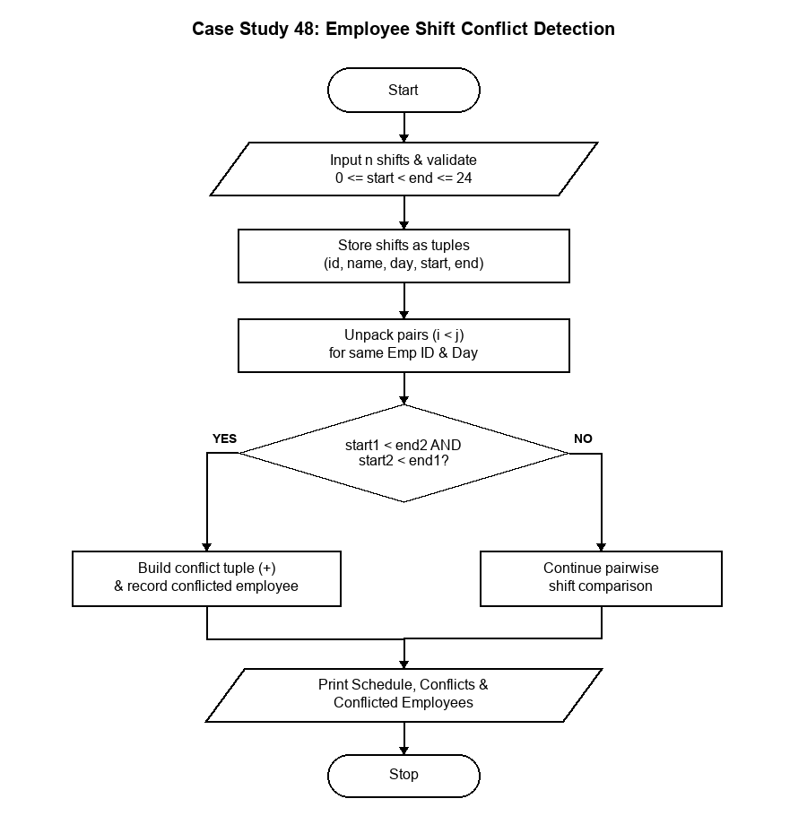
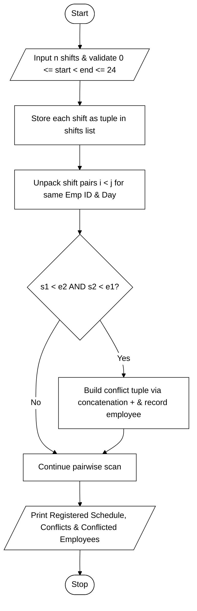
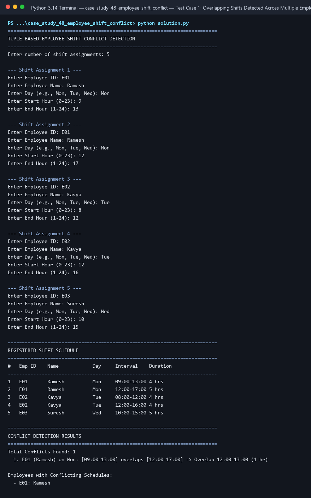
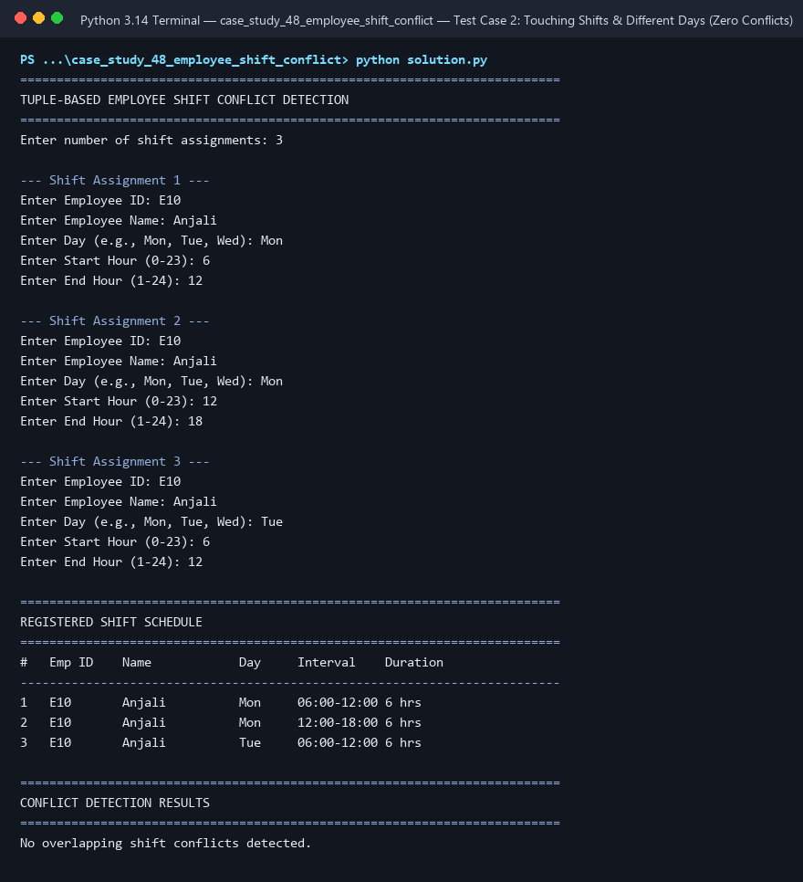
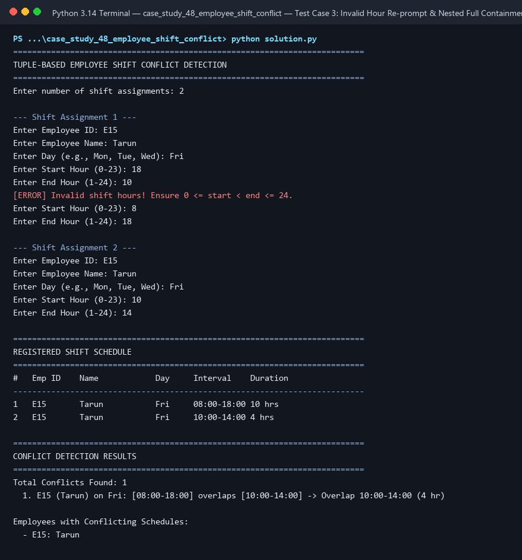

# Case Study 48: Tuple-Based Employee Shift Conflict Detection

- **Student Roll Number:** `26000639`
- **Source Code:** [solution.py](./solution.py)
- **Standalone Files:** [algorithm.md](./algorithm.md) | [pseudocode.md](./pseudocode.md) | [flowchart.png](./flowchart.png)
- **Syllabus Concepts Used:** Computational thinking, algorithms, flowcharts, pseudocode, variables, data types, operators, conditional statements, loops, strings, lists, tuples, tuple operations, unpacking.

---

## 1. Problem Statement
Develop a Python system that represents employee work shifts as tuples `(emp_id, emp_name, day, start_hr, end_hr)`, validates time intervals, compares shift intervals across assignments using tuple unpacking and tuple concatenation, detects overlapping schedules, and lists all affected employees.

## 2. Objectives
- Validate shift boundaries (`0 <= start_hr < end_hr <= 24`).
- Store immutable shift assignments as 5-element tuples inside a schedule list.
- Unpack pairs `(i, j)` with `i < j` to avoid duplicate self-comparisons and check same-employee, same-day overlaps (`s1 < e2 and s2 < e1`).
- Use tuple concatenation (`+`) and indexing to build and report detailed overlap intervals.

## 3. Assumptions
- Shift hours use 24-hour integer boundaries `[start_hr, end_hr)` where touching shifts (e.g., `08:00–12:00` and `12:00–16:00`) do **not** overlap.
- Shifts are compared for the same `emp_id` on the same `day` (case-insensitive).

## 4. Algorithm
1. **Start** and read `n` shift assignments.
2. For each shift `i`:
   - Read `emp_id`, `emp_name`, `day`, `start_hr`, `end_hr`.
   - Validate `0 <= start_hr <= 23` and `start_hr < end_hr <= 24` in a `while` loop.
   - Store `shift_tuple = (emp_id, emp_name, day, start_hr, end_hr)` in `shifts`.
3. Print the formatted registered shift schedule by unpacking each tuple.
4. Use nested loops `i = 0..len(shifts)-1` and `j = i+1..len(shifts)-1`:
   - Unpack `shifts[i]` and `shifts[j]`.
   - If `id1 == id2` and `day1.lower() == day2.lower()` and `s1 < e2 and s2 < e1`:
     - Compute `overlap_start = max(s1, s2)` and `overlap_end = min(e1, e2)`.
     - Construct `conflict_rec` using tuple concatenation `+` and append to `conflicts`; track unique `(id1, name1)` pairs in `conflicted_employees`.
5. Display all conflict pairs with exact overlap windows and unique conflicted employees.
6. **Stop**.

## 5. Flowchart





## 6. Pseudocode
```text
BEGIN
    INPUT n
    SET shifts = []
    FOR i = 1 TO n DO
        INPUT emp_id, emp_name, day, start_hr, end_hr
        WHILE start_hr < 0 OR start_hr > 23 OR end_hr <= start_hr OR end_hr > 24 DO
            PRINT error and re-input start_hr, end_hr
        END WHILE
        APPEND (emp_id, emp_name, day, start_hr, end_hr) TO shifts
    END FOR
    SET conflicts = [], conflicted_employees = []
    FOR i = 0 TO LENGTH(shifts) - 1 DO
        (id1, name1, day1, s1, e1) = shifts[i]
        FOR j = i + 1 TO LENGTH(shifts) - 1 DO
            (id2, name2, day2, s2, e2) = shifts[j]
            IF id1 == id2 AND LOWER(day1) == LOWER(day2) AND s1 < e2 AND s2 < e1 THEN
                overlap_start = MAX(s1, s2), overlap_end = MIN(e1, e2)
                APPEND (id1, name1, day1) + ((s1, e1), (s2, e2), overlap_start, overlap_end, overlap_end - overlap_start) TO conflicts
                IF (id1, name1) NOT IN conflicted_employees THEN APPEND (id1, name1) TO conflicted_employees
            END IF
        END FOR
    END FOR
    PRINT schedule, conflicts, conflicted_employees
END
```

## 7. Test Cases

| Test Case | Scenario | Key Inputs | Expected Outcome | Status |
| :--- | :--- | :--- | :--- | :--- |
| **TC 1** | Overlapping vs touching shifts across 3 employees | `E01` Mon `9–13` & `12–17`; `E02` Tue `8–12` & `12–16`; `E03` Wed `10–15` | Detects 1 conflict (`E01` Mon `12:00–13:00`, `1 hr`); `E02` touching shifts do not conflict | Passed |
| **TC 2** | Back-to-back & cross-day shifts (zero conflicts) | `E10` Mon `6–12`, Mon `12–18`, Tue `6–12` | Reports `No overlapping shift conflicts detected.` | Passed |
| **TC 3** | Invalid hour recovery (`18..10` -> `8..18`) & full containment overlap | `E15` Fri `18–10` (re-prompted to `8–18`) and `10–14` | Prints `[ERROR]` on invalid range, then detects `10:00–14:00 (4 hr)` containment overlap | Passed |

## 8. Output Screenshots

### Test Case 1


### Test Case 2


### Test Case 3


## 9. Conclusion
The Tuple-Based Employee Shift Conflict Detection system showcases practical use of tuples for structured immutable records, tuple unpacking for readable pairwise interval math, and tuple concatenation for building audit reports.
