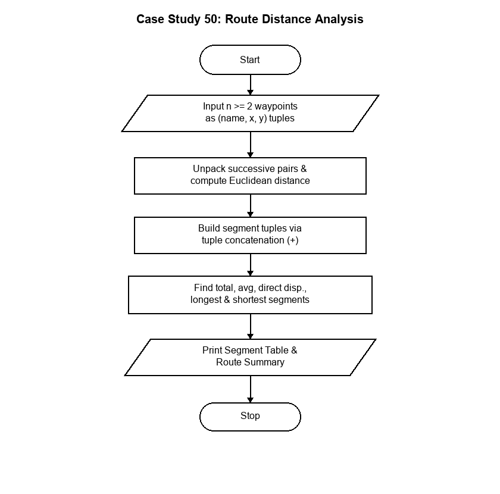
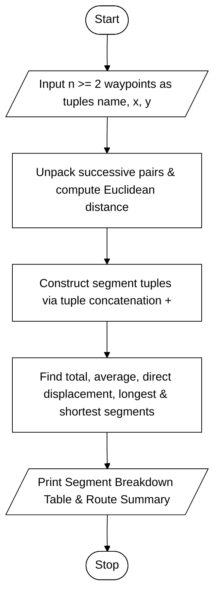
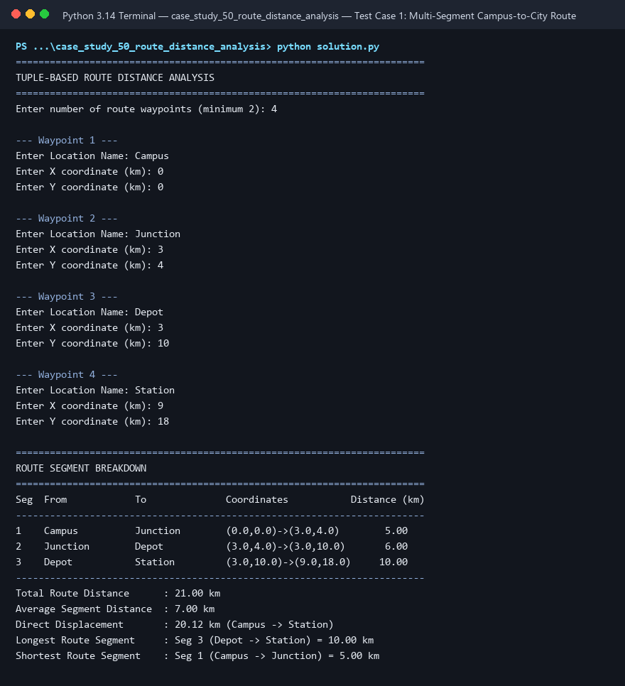
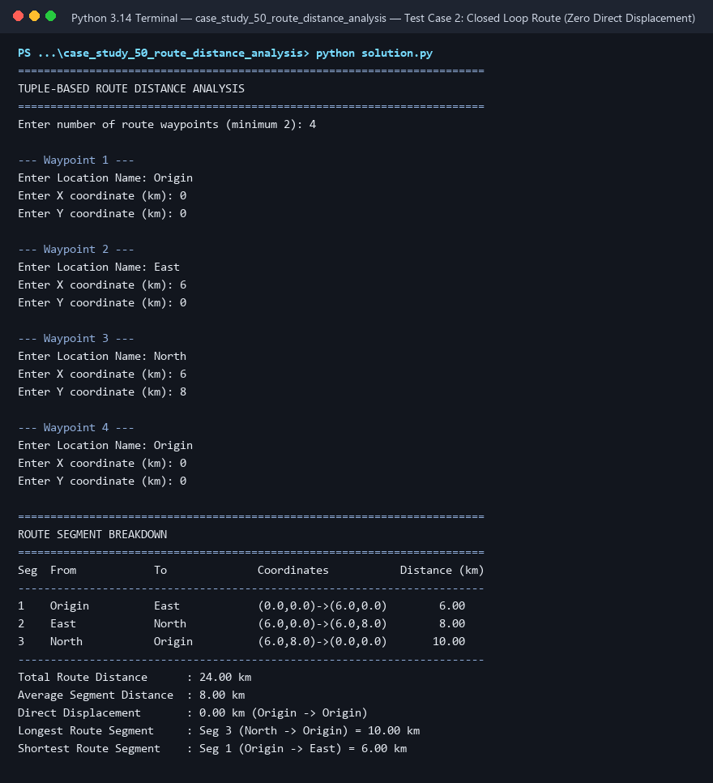
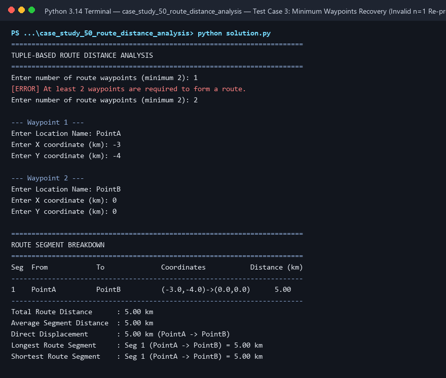

# Case Study 50: Tuple-Based Route Distance Analysis

- **Student Roll Number:** `26000639`
- **Source Code:** [solution.py](./solution.py)
- **Standalone Files:** [algorithm.md](./algorithm.md) | [pseudocode.md](./pseudocode.md) | [flowchart.png](./flowchart.png)
- **Syllabus Concepts Used:** Computational thinking, algorithms, flowcharts, pseudocode, variables, data types, operators, conditional statements, loops, strings, lists, tuples, tuple operations, unpacking.

---

## 1. Problem Statement
Develop a Python application that stores route waypoints as coordinate tuples `(name, x, y)`, unpacks successive coordinate pairs to calculate segment distances using the Euclidean distance formula, aggregates segment tuples using tuple concatenation, and identifies total distance, average segment distance, direct displacement, and the longest and shortest route segments.

## 2. Objectives
- Enforce minimum route requirement (`>= 2` waypoints) via input validation loop.
- Represent 2D waypoints as tuples and unpack adjacent pairs `(name1, x1, y1)` and `(name2, x2, y2)`.
- Compute Euclidean distance using pure arithmetic operators `((dx * dx) + (dy * dy)) ** 0.5` without external imports.
- Demonstrate tuple concatenation (`+`) and negative tuple/list indexing (`waypoints[-1]`) to compute direct end-to-end displacement.

## 3. Assumptions
- Coordinates `(x, y)` represent planar Cartesian positions in kilometers (`km`).
- Route segments follow sequential waypoint order `1 -> 2 -> ... -> n`.

## 4. Algorithm
1. **Start** and read `n`; re-prompt while `n < 2`.
2. Loop `i` from `1` to `n` to read `label`, `x`, `y` and append `(label, x, y)` to `waypoints`.
3. Initialize `segments = []` and `total_distance = 0.0`.
4. Loop `i` from `0` to `len(waypoints) - 2`:
   - Unpack `waypoints[i]` into `name1, x1, y1` and `waypoints[i + 1]` into `name2, x2, y2`.
   - Compute `dist = (((x2 - x1) ** 2) + ((y2 - y1) ** 2)) ** 0.5` and add to `total_distance`.
   - Build `seg = (i + 1, name1, name2) + ((x1, y1), (x2, y2), round(dist, 2))` and append to `segments`.
5. Scan `segments` to locate `longest_seg` and `shortest_seg`; compute `avg_distance = total_distance / len(segments)`.
6. Unpack `waypoints[0]` and `waypoints[-1]` to calculate `direct_displacement`.
7. Display the segment breakdown table and route summary statistics.
8. **Stop**.

## 5. Flowchart





## 6. Pseudocode
```text
BEGIN
    INPUT n
    WHILE n < 2 DO
        PRINT error and INPUT n
    END WHILE
    SET waypoints = []
    FOR i = 1 TO n DO
        INPUT label, x, y
        APPEND (label, x, y) TO waypoints
    END FOR
    SET segments = [], total_distance = 0
    FOR i = 0 TO LENGTH(waypoints) - 2 DO
        (name1, x1, y1) = waypoints[i]
        (name2, x2, y2) = waypoints[i + 1]
        dist = ((x2 - x1)^2 + (y2 - y1)^2) ^ 0.5
        total_distance = total_distance + dist
        seg = (i + 1, name1, name2) + ((x1, y1), (x2, y2), ROUND(dist, 2))
        APPEND seg TO segments
    END FOR
    Find longest_seg, shortest_seg, avg_distance, and direct_displacement (waypoints[0] to waypoints[-1])
    PRINT segment table and summary
END
```

## 7. Test Cases

| Test Case | Scenario | Key Inputs | Expected Outcome | Status |
| :--- | :--- | :--- | :--- | :--- |
| **TC 1** | 4-waypoint campus-to-city route | `(0,0) -> (3,4) -> (3,10) -> (9,18)` | Segment distances `5.00`, `6.00`, `10.00`; Total `21.00 km`, Avg `7.00 km`, Direct `20.12 km`, Longest `Seg 3 (10.00 km)` | Passed |
| **TC 2** | Closed-loop triangular route | `(0,0) -> (6,0) -> (6,8) -> (0,0)` | Total `24.00 km`, Avg `8.00 km`, Direct Displacement `0.00 km`, Longest `Seg 3 (10.00 km)` | Passed |
| **TC 3** | Invalid waypoint count recovery (`1 -> 2`) & negative coords | `n = 1` (re-prompted `2`), `(-3,-4) -> (0,0)` | Displays `[ERROR] At least 2 waypoints`, computes `5.00 km` route distance | Passed |

## 8. Output Screenshots

### Test Case 1


### Test Case 2


### Test Case 3


## 9. Conclusion
The Tuple-Based Route Distance Analysis system effectively combines coordinate tuples, tuple unpacking, tuple concatenation, and arithmetic operators to analyze multi-segment routes cleanly without external libraries.
